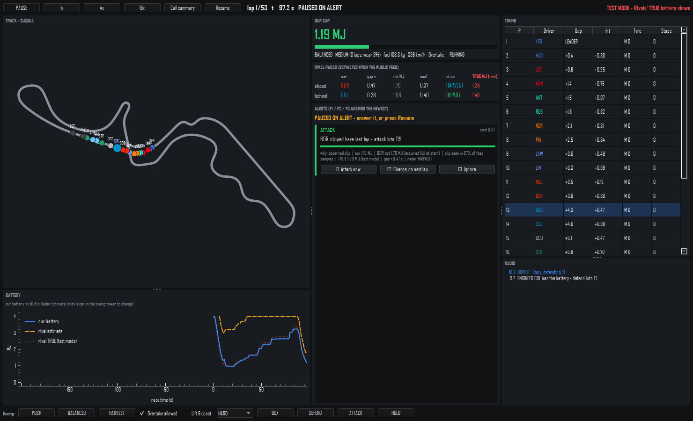

# We Are Racing, Not Testing

**What this is:** in 2026 half of a Formula 1 car's power comes from its battery,
and every rival's battery is hidden. This desktop simulator puts you on the pit
wall of one car at Suzuka: you see your own car exactly, the rivals only through
public timing, a noisy 4 Hz feed and a Radar Estimate of their battery. The pit
wall raises alerts (ATTACK, DEFEND, RE-PASS RISK, CLOSING-SPEED RISK), you call
the driver with F1 / F2 / F3, and after the flag a call summary shows how each
call worked out. A test bench exports races with full Ground Truth and scores
battery estimators (your own plugs in; see below).



Personal use only (real team and driver names). Specs are in `docs/` (start with
`CLAUDE.md` and `docs/spec/PRD.md`); the 3-minute demo script is `docs/guides/DEMO.md`.

## Quick start (Windows)

Run the commands below one line at a time. Don't paste the comment lines that
start with `#` into the terminal: PowerShell and cmd can treat `#`, `if` or
`skip` as arguments (that is how stray folders named `#`, `if` and `skip`
appeared in the repository root once).

Needs Python 3.13. No GPU, no network: the Suzuka track
model is in the repository (`data/tracks/suzuka.parquet`).

```powershell
git clone https://github.com/Dronzer2code/We_are_racing-not_testing---F1sim_lite.git
cd We_are_racing-not_testing---F1sim_lite
py -3.13 -m venv .venv
.venv\Scripts\Activate.ps1
python -m pip install --upgrade pip
pip install -e ".[dev]"
```

If PowerShell refuses to run `Activate.ps1`, run
`Set-ExecutionPolicy -Scope CurrentUser RemoteSigned` once, or call the tools as
`.venv\Scripts\python`.

### Run the app

```powershell
python main.py
```

The first start compiles the simulation kernel (Numba) and takes longer; later
starts are quick.

1. **Race setup.** Pick Rule Set, your team and driver, the seed, and a
   **Scenario**:
   - `None`: a normal race from the grid order.
   - `Re-pass scenario`: you start P10 on 2.0 MJ, pushing and attacking the car
     ahead, which starts with an empty battery. Pass it early and you are low on
     the next long straight: a RE-PASS RISK alert comes within the first 3 laps.
   - `Closing-speed scenario`: you start P14; the cars in P7-P9 start empty and
     clip on the straights, so you close on them fast: a CLOSING-SPEED RISK
     alert comes within the first lap or two.
2. **Pause on alert** stops the race at each new alert until you answer it.
3. **Test mode** shows the rivals' TRUE battery next to the Radar Estimate and,
   in the call summary, whether each alert was right. A real team cannot see
   this; use it to check the alerts, not to race.
4. **Start race.** The pit wall shows the track map, timing tower, battery trace
   and the alert feed. Speed: PAUSE / 1x / 4x / 16x (Space pauses).
5. **Answer an alert** with its buttons or **F1 / F2 / F3** (newest alert).
   Click an alert to see its evidence: which rule fired (energy, observed clip,
   own battery), the batteries, the gap. Unanswered alerts expire after 8 s.
   - ATTACK [1] *Attack now*: the driver attacks for up to 2 laps or until the
     pass is made, in PUSH, using all the grip to stay in the tow, Overtake mode when
     available.
   - DEFEND [1] *Defend into &lt;corner&gt;*: inside line and deploy kept for the
     straights until the car behind is more than 1.0 s back or has passed (at
     most 2 laps).
   - You can also send commands directly: Energy Mode, DEFEND, ATTACK, BOX.
6. **Call summary** (button, and it opens by itself at the flag): every alert,
   what you called (or ignored / expired), what happened in the next 2 laps, and
   the totals (calls made, successful attacks and defends; in Test mode, alerts
   right per Ground Truth).

### Command-line checks

```powershell
# Every alert one race would raise for Our Car, with the rule that fired.
python -m pitwall_sim.observe.alerts_check --seed 42 --our GAS

# Does a call change the race? Paired forks at the first alert, answered vs ignored.
python -m pitwall_sim.engineer.call_outcome --type ATTACK --seeds 20 --variants 5
python -m pitwall_sim.engineer.call_outcome --type DEFEND --seeds 20 --variants 5
python -m pitwall_sim.engineer.call_outcome --overtakes 3      # overtakes per race

# Export a race for Simply Clipping (FastF1-like feed + 10 Hz Ground Truth), then score
# the built-in Radar and alerts on it (docs/spec/SIMPLY_CLIPPING_BRIDGE.md).
python -m pitwall_sim.export --seed 42 --scenario normal --out data/exports/suzuka_normal_s42
python -m pitwall_sim.evaluate --run data/exports/suzuka_normal_s42 --baseline

# Test bench for your own estimator package (export -> your module -> scorer -> report);
# my_clipping is your module's name (docs.examples.hello_clipping is the template).
python -m pitwall_sim.bench --sc-module my_clipping --scenario all --seeds 6-10

# A headless race, and the replay viewer (records the race, then plays it).
python -m pitwall_sim.race.engine --headless --track suzuka --rules 2026_post_miami --seed 42
python -m pitwall_sim.viewer --seed 42
```

### Tests

```powershell
pytest -q                 # all tests (about 5 minutes)
ruff check . ; ruff format --check .
mypy pitwall_sim
lint-imports              # architecture contracts: headless core, information barrier
```

The timing tests (headless race runtime, step-kernel speed, a 16x UI frame) need
a quiet machine; close games and video calls first.

## Results (built-in baseline)

`docs/results/SC_RESULTS.md` scores the sim's built-in Radar and alert rules, and a dumb
rule ("car ahead slower on this straight → ATTACK"), over 60 full Suzuka races
(10 seeds x 6 scenarios; seeds 1-5 tune set, 6-10 test set). Test set, built-in:

| Measure | Built-in |
| --- | --- |
| Battery estimate error (MAE) | 0.84-0.97 MJ (1.28 MJ in the taper scenario) |
| CLIP precision / recall | 4-6 % / 35-41 % |
| False CLIP while the MGU-K taper limits deploy | 0-1 % |
| ATTACK alerts right per Ground Truth | 14-71 % by scenario (46 % in a normal race) |
| Normal race ATTACK recall / precision | 75 % / 8 % (dumb rule 100 % / 6 %) |
| Incident check (alert before the event) | repass 33 %, closing speed 0 % |

These are the numbers an estimator plugged into the bench has to beat
(`docs/spec/SIMPLY_CLIPPING_BRIDGE.md`):

```powershell
python -m pitwall_sim.bench --sc-module docs.examples.hello_clipping --scenario normal --seeds 6
```

## Simply Clipping

`simply_clipping/` is the owner's rival battery estimator, built as a plug-in of the
simulator (spec: `docs/spec/SIMPLY_CLIPPING_SPEC.md`). From each rival's public
telemetry it estimates the hidden battery (speed → acceleration → wheel power →
electric power, CdA fitted per car, states DEPLOY / CLIP / HARVEST / LIFT / CRUISE,
anchors that tell a super-clip from an empty battery, honest confidence) and raises
the pit-wall alerts (ATTACK, DEFEND, RE-PASS RISK, CLOSING-SPEED RISK), each with a
one-line radio call. It never imports the simulator and never reads Ground Truth.

```powershell
# Bench: export -> Simply Clipping -> scorer -> data/sc_out/simply_clipping/BENCH_REPORT.md
python -m pitwall_sim.bench --sc-module simply_clipping --scenario normal --seeds 6

# Live: in config/app.yaml set   alerts: provider: external:simply_clipping   then
python main.py

# The real 2026 Japanese GP (OpenF1, cached in data/openf1_cache/), Our Car = NOR
python -m simply_clipping.real_data --session 11253 --our NOR --out data/sc_real/jpn2026_nor
```

Results (v1, tag `sc-v1`; test set, seeds 6-10, run once; tuning on seeds 1-5
only, `docs/results/SC_TUNING.md`; tables in `docs/results/SC_RESULTS.md`):

| Measure | Built-in | Simply Clipping |
| --- | --- | --- |
| Battery estimate error (MAE) | 0.84-1.28 MJ | 0.36-0.88 MJ (lower in every scenario) |
| Estimates within 0.5 MJ of the truth | 20-41 % | 38-73 % |
| Confidence honesty (ECE; 0 = stated confidence matches the hit rate) | 18-34 % | 4-10 % (0.9 % pooled) |
| CLIP precision / recall | 4-6 % / 35-41 % | 53-66 % / 19-27 % |
| ATTACK alerts right per Ground Truth | 14-71 % | 19-98 % |
| DEFEND recall | 25-60 % | 38-91 % |
| Repass incident caught | 33 % | 67 % |
| Closing-speed incident caught | 0 % | 0 % (spec O-3) |
| Normal-race ATTACK precision | 8 % | 0 % (ATTACK rarely fires there) |
| Alerts per race | 30-64 | 30-77 |

Real race: in the 2026 Japanese GP it raised RE-PASS RISK when Norris passed
Hamilton (laps 47 and 50), 15 s and 20 s before Hamilton re-passed; the lap-22
Bearman / Colapinto crash is not caught (Bearman's speed channel is frozen before
the impact). Demo script: `docs/guides/DEMO_SC.md`.

## Where things are

| Path | What |
| --- | --- |
| `pitwall_sim/race/` | Race engine, step kernel, overtakes, pit lane, weather, rival strategy |
| `pitwall_sim/observe/` | Public Feed, Rival Battery Radar, EngineerView, alert providers |
| `pitwall_sim/export/`, `pitwall_sim/evaluate/`, `pitwall_sim/bench/` | Race export, scorer, batch, test bench |
| `pitwall_sim/engineer/` | Engineer Commands, call options, call outcome check |
| `pitwall_sim/live/` | Live session (no Qt), setup presets |
| `pitwall_sim/ui/` | Setup screen and live pit wall |
| `simply_clipping/` | The owner's battery estimator and alerts (plug-in), `config.yaml`, tests |
| `config/` | Rule Sets, grid, teams, tyres, Suzuka, `app.yaml` (every tunable value) |
| `docs/` | PRD, MVP, TRD, process flow, UI design, tasks, setup, sprint |
