# PROCESS_FLOW.md — Pit Wall Race Simulator (2026 Regulations)

## PURPOSE

This document defines HOW `pitwall_sim` works at runtime: user journeys, the simulation loop, command flow, information flow, radio, events, debrief, compare modes, and offline pipelines.

Names, feature IDs (`F01`–`F20`) and requirement IDs come from `PRD.md`. Data contracts, modules and parameters come from `TRD.md`. Build order comes from `MVP.md`. Flows marked (R2)–(R5) are not part of the MVP.

## CONTEXT

The user is the race engineer of one car (Our Car) in a simulated 22-car 2026 F1 race. The simulator holds Ground Truth for every car. The in-race UI receives only an `EngineerView`: Our Car's Ground Truth, public timing, the noisy Public Feed for Rivals, and Radar Estimates of Rival battery energy. The user issues Engineer Commands by buttons or by free-text radio; AI Drivers carry them out.

## FLOW INDEX

| # | Flow | Features |
| --- | --- | --- |
| PF-01 | Offline: track build | F01, F20 |
| PF-02 | Offline: calibration | F20 |
| PF-03 | App start and race setup | F03, F15, F19 |
| PF-04 | Simulation tick | F02, F04, F05, F06, F07 |
| PF-05 | Clock and UI refresh | F09, F15 |
| PF-06 | Information flow and barrier | F10, F11, F15 |
| PF-07 | Engineer command by button | F12 |
| PF-08 | Engineer command by radio | F12, F14 (R3) |
| PF-09 | Driver unprompted radio | F14 (R3) |
| PF-10 | Rival strategy decision | F08 |
| PF-11 | Overtake resolution | F05 |
| PF-12 | Pit stop | F05, F12 |
| PF-13 | Incident → VSC / SC / red flag | F06 (R2) |
| PF-14 | Weather change | F07 (R2) |
| PF-15 | Strategy predictor | F13 (R2) |
| PF-16 | Race end and debrief | F16 (R3) |
| PF-17 | Compare Mode — Decision Points | F17 (R4) |
| PF-18 | Compare Mode — Alternate Race | F18 (R4) |

## IMPLEMENTATION STATUS

Checked against the code on 2026-10-28 (after sprint day 9, commit `e426bb3`).
Every flow below also has a **Status** block under its heading with the details:
what is done (and where), what needs refinement, and what is not implemented yet.
Task IDs refer to `docs/planning/TASKS.md`; the whole-project picture is in
`docs/status/PROJECT_STATUS.md`.

| Status | Meaning |
| --- | --- |
| DONE | Every step in the diagram exists in code and is tested |
| DONE, needs refinement | Works end to end, but a step differs from the diagram, uses placeholder values, or lacks a UI part |
| PARTIAL | Some steps are built, others are missing |
| NOT IMPLEMENTED | Only stub modules (one-line files) exist |

| # | Flow | Status | Remaining work |
| --- | --- | --- | --- |
| PF-01 | Offline: track build | DONE, needs refinement | Higher-resolution geometry (`T-02D`); other tracks (`T-400`, `T-401`, R5) |
| PF-02 | Offline: calibration | PARTIAL | Single-car loop done (provisional); race loop `T-02C`, start fuel `T-02B`, final fit `T-02D` |
| PF-03 | App start and race setup | PARTIAL | Harvest field + start validation (`T-071`), grid choice, weather preset; modes (R4); Gemma load (R3) |
| PF-04 | Simulation tick | DONE, needs refinement | VSC / SC in the events stage (`T-038`); diagram vs. per-interval stages |
| PF-05 | Clock and UI refresh | PARTIAL | "Sim behind" indicator, full window (`T-070`), traces (`T-075`), UI test (`T-077`) |
| PF-06 | Information flow and barrier | DONE | Test-mode exception is an owner decision; debrief release with PF-16 (R3) |
| PF-07 | Engineer command by button | DONE, needs refinement | Buttons for 4 command types, shortcuts (`T-076`) |
| PF-08 | Engineer command by radio (R3) | NOT IMPLEMENTED | `T-200`, `T-201`, `T-203`, `T-206`–`T-208` |
| PF-09 | Driver unprompted radio (R3) | NOT IMPLEMENTED | MVP template triggers (no R1 task covers them), `T-202` |
| PF-10 | Rival strategy decision | PARTIAL | SC / VSC and weather branches (`T-062`); HOLD variant (owner); values (`T-02C`) |
| PF-11 | Overtake resolution | DONE, needs refinement | Calibrated weights (`T-02C`); contact → incident (`T-038`) |
| PF-12 | Pit stop | DONE | BOX under SC cheaper (MVP-13) comes with `T-038` / `T-062` |
| PF-13 | Incident → VSC / SC / red flag | NOT IMPLEMENTED | `T-038` (incidents, VSC, SC; R1), `T-102` (red flag, track limits, penalties; R2), `T-078` banners |
| PF-14 | Weather change | PARTIAL | Rival reactions (`T-062`), UI display (`T-078`), radio trigger (R3) |
| PF-15 | Strategy predictor (R2) | NOT IMPLEMENTED | `T-105` |
| PF-16 | Race end and debrief (R3) | NOT IMPLEMENTED (sprint call summary stands in) | `T-204`, `T-205` |
| PF-17 | Compare Mode — Decision Points (R4) | NOT IMPLEMENTED | `T-300`, `T-301`, `T-303` |
| PF-18 | Compare Mode — Alternate Race (R4) | NOT IMPLEMENTED | `T-302`, `T-303` |

Totals: 2 DONE, 4 DONE needing refinement, 5 PARTIAL, 7 NOT IMPLEMENTED.

### Built flows this document does not describe yet (sprint, 2026-10-26 to 2026-10-31)

| Flow | Where it is specified | Code |
| --- | --- | --- |
| Alert → call the driver: `AlertProvider.update(EngineerView)` raises ATTACK / DEFEND / RE-PASS RISK / CLOSING-SPEED RISK; the engineer answers with F1 / F2 / F3; each option becomes validated Engineer Commands (PF-07 path) with a template radio line and ack; ATTACK / DEFEND calls last until the situation is over (at most 2 laps); optional pause on alert | `docs/planning/SPRINT.md` Part 2; `docs/status/SESSION_CONTEXT.md` DAY 4–5 | `observe/alerts.py`, `engineer/calls.py`, `live/session.py`, `ui/pitwall_lite.py` |
| End-of-race call summary: every alert with the option chosen / ignored / expired and the outcome in the next 2 laps; in Test mode, whether the alert was right | `docs/planning/SPRINT.md` Part 2 (A-4) | `live/session.py` (`CallSummary`), `ui/pitwall_lite.py` (`SummaryDialog`) |
| Scenario presets (Re-pass, Closing-speed) at race setup | `docs/status/SESSION_CONTEXT.md` DAY 4 | `live/presets.py` |
| Replay of a simulated race (record headless, then play) | `docs/planning/TASKS.md` S-2 | `viewer/` |
| Export → estimator plug-in → scorer → report (test bench, batch) | `docs/spec/SIMPLY_CLIPPING_BRIDGE.md` | `export/`, `evaluate/`, `bench/` |

## PF-01 OFFLINE: TRACK BUILD

**Status (2026-10-28): DONE, needs refinement.**

- Done: `track/builder.py`: FastF1 first, OpenF1 fallback (owner round 5, the normal
  path without an F1TV login); the fastest 5 clean laps pooled (`T-029`), 1 m
  resampling, curvature, automatic straights, closed-loop and ±1 % length checks, exit
  status 2 = `UNAVAILABLE`. `track/landmarks.py` prints corners and pit positions as a
  YAML fragment; derived acceleration zones (`track/accel_zones.py`, `T-027`) are stored
  in `suzuka.yaml` but not applied. `data/tracks/suzuka.parquet` is committed.
- Needs refinement: step G / I: manual entries and zone `s` values are printed for a
  person to copy, not written into the config by the builder. Geometry from a
  higher-resolution circuit outline with a per-corner source (`T-02D`, parked); the
  current speed RMSE of 21–25 km/h is partly geometry. The setup screen offers Suzuka
  only (hard-coded), not a track picker that drops `UNAVAILABLE` tracks.
- Not implemented: every other 2026 track (`T-400`, `T-401`, R5).

Runs once per track; output is committed to `data/tracks/<track_id>.parquet`.

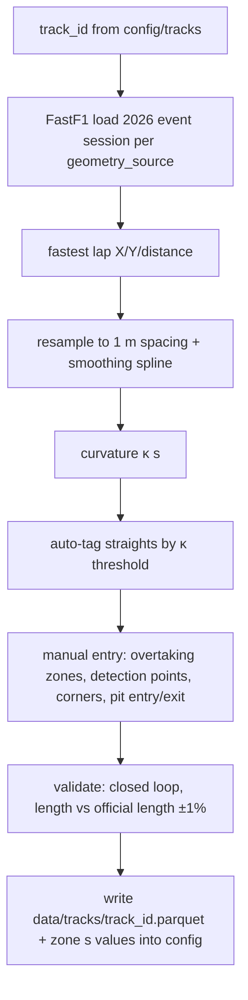

Failure: if FastF1 has no 2026 session for the track → track status `UNAVAILABLE`, excluded from track picker.

## PF-02 OFFLINE: CALIBRATION

**Status (2026-10-28): PARTIAL.**

- Done: the single-car loop (steps A–D): `calibration/compare.py` (lap time delta and
  speed RMSE against the OpenF1 reference), `calibration/fit.py` (fits the coefficients,
  writes `docs/results/CALIBRATION_NOTES.md`), `calibration/deploy_policy.py`.
  Values are CALIBRATED-PROVISIONAL (`T-02A` fit 2): every team within 2 % of its
  target, order within ±2.
- Needs refinement: plausibility limits (lateral ≤ 5.5 g, braking ≤ 6.0 g) not met and
  speed RMSE 21–25 km/h against ≤ 15 km/h (`T-02D`); `test_calibrated_lap_is_plausible`
  is skipped while the values are provisional; `fit.py` rewrites the whole notes file,
  including its hand-written sections.
- Not implemented: the race loop (steps E–G: full races × 20 seeds against overtakes,
  degradation slope and SC rate) is `T-02C` (parked); start fuel `T-02B` (parked: at
  the 70 kg placeholder every car runs out of fuel at laps 41–46 of 53); the SC rate needs
  `T-038`. Tooling that exists: `python -m pitwall_sim.engineer.call_outcome --overtakes N`
  counts overtakes per race.

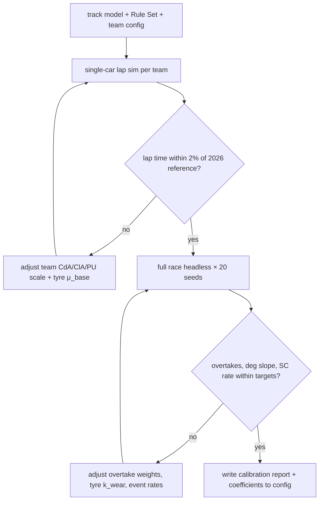

## PF-03 APP START AND RACE SETUP

**Status (2026-10-28): PARTIAL (sprint "pit wall lite" version).**

- Done: `python main.py` → `ui/setup_screen.py` (track, Rule Set, team and driver = Our
  Car, seed, Race laps, Scenario preset, Pause on alert, Test mode) → `live/session.py`
  `LiveSession` → `ui/pitwall_lite.py` `PitWallWindow`, which draws the first frame at
  once and starts at 1x. Config comes from `app.yaml`, the Rule Sets, `real_2026.yaml` and
  the track file.
- Needs refinement: the checks before start are missing from the UI: `UNRESOLVED` keys
  are only logged as a warning (5 track keys today) and Our Car / track status are not
  validated there. The engine accepts a harvest-limit override
  (`RaceSetup.harvest_limit_mj`, resolved by `resolve_harvest_limit_mj`), but the setup
  screen has no Harvest limit field (`T-071`, parked). The grid is fixed to
  `real_2026` (the fictional grid, F19, cannot be chosen). No formation lap: the race
  starts from the grid.
- Not implemented: the mode choice (Compare modes, R4), the weather preset (the engine
  can force dry or rain; the setup screen does not offer it), and Gemma load + warm-up
  (`T-200`, R3).

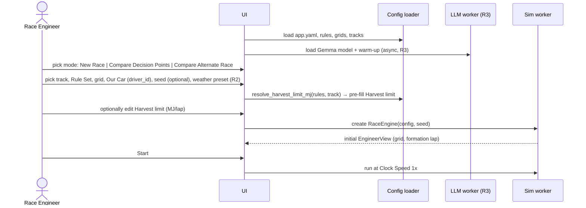

Validation before start: Rule Set loads with no runtime `UNRESOLVED` values; track status not `UNAVAILABLE`; Our Car exists in grid; Harvest limit > 0.

## PF-04 SIMULATION TICK

**Status (2026-10-28): DONE, needs refinement.**

- Done: `race/engine.py` `RaceEngine.tick` runs the stages in this order: commands due,
  decision tick every 1.0 s (`rival_strategy` + `ai_driver.decide`), weather, the Numba
  kernel (`race/step_kernel.py`), overtake, pit, events (driver mistakes and
  retirements), timing (laps, sectors, gaps, finish), Public Feed at 4 Hz, and an
  automatic Snapshot each time the leader crosses the timing line. Measured: 7.05 s for a
  full 22-car race headless (budget 10 s).
- Needs refinement: the diagram shows every stage once per 0.05 s step. The code runs
  the stages other than the kernel once per feed interval (0.25 s = 5 physics steps;
  the kernel records line crossings at their exact step time), and weather at
  decision ticks. This is documented in `engine.py` and keeps the time budget; the
  diagram should say so.
- Not implemented: `events.step` for VSC / SC / red flag (PF-13, `T-038`; `race/events.py`
  is a stub).

One physics step of `dt = 0.05 s`.

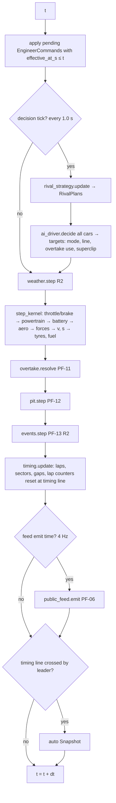

## PF-05 CLOCK AND UI REFRESH

**Status (2026-10-28): PARTIAL.**

- Done: `SimThread` (`ui/pitwall_lite.py`) advances the race by wall time × speed (PAUSE /
  1x / 4x / 16x, Space pauses) without skipping physics steps (HR-08) and emits a frame
  (`EngineerView` + alerts) at 30 Hz. Panels: track map, timing tower, Our Car status,
  Rival radar (car ahead / behind), battery trace, alert feed, radio log, command bar.
  Measured: slowest frame 32 ms at 16x (limit 100 ms).
- Needs refinement: there is no "sim behind" indicator: when the machine is too slow the
  sim clock lags silently (at most 1 s of sim time per loop). The trace panel shows the
  battery only (UI_DESIGN asks for 4 linked plots with a previous-lap ghost, `T-075`). The
  radar panel shows the cars directly ahead and behind, not every Rival.
- Not implemented: the full UI_DESIGN window (`ui/window.py`, `ui/clock.py`,
  `ui/timing_tower.py`, `ui/track_map.py`, `ui/radar_panel.py`, `ui/telemetry_plot.py` are
  stubs: `T-070`–`T-075`, parked while S-5 replaces them), the UI performance test
  `T-077`, and the strategy panel (R2).

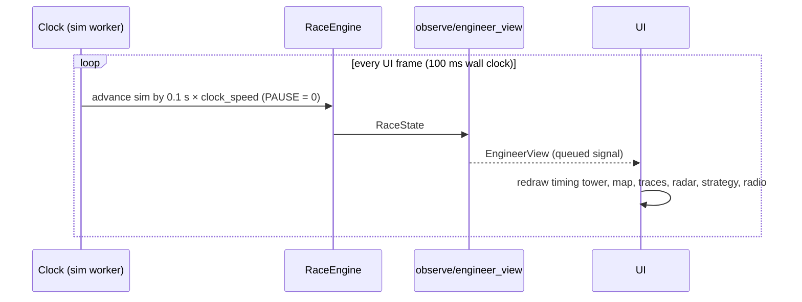

Rules:
- At `16x`, the sim advances 1.6 s (32 steps) per frame; if it cannot finish in the frame budget, the clock drops effective speed and shows a "sim behind" indicator. The sim MUST NOT skip physics steps.
- `PAUSE` stops simulated time; UI remains interactive; commands issued during pause take effect at `t + radio_latency_s` after resume.

## PF-06 INFORMATION FLOW AND BARRIER

**Status (2026-10-28): DONE.**

- Done: `observe/public_feed.py` (4 Hz, noise, dropout, public timing),
  `observe/radar/` (fed only by the Public Feed), `observe/engineer_view.py` + the
  `test_info_barrier` test, and four import contracts (`lint-imports`: headless core,
  UI reads only EngineerView, alert providers read only EngineerView, Radar sees only the
  Public Feed). The Rival Strategy AI reads opponents only through Radar Estimates
  (without the start prior).
- Needs refinement (owner-approved deviations, documented): Test mode shows the Rivals'
  TRUE battery during the race and in the call summary, clearly labelled (sprint S-5),
  so the "only after race end" rule holds only outside Test mode; Rivals see Our Car in
  the Public Feed (sprint day 7). Radar accuracy after the first anchor: MAE ≈ 1.44 MJ,
  bias −1.41 MJ, confidence low until anchors arrive (owner rule: never tune it on Ground
  Truth).
- Not implemented: releasing Ground Truth to a debrief view (PF-16, R3).

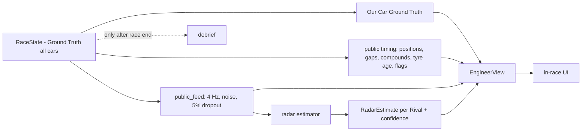

Barrier rules:
- `ui/` MUST receive only `EngineerView`.
- Rival `battery_mj`, `energy_mode`, `tyre_wear`, `fuel_kg`, `RivalPlan` MUST NOT appear in `EngineerView`.
- Rival Strategy AI and Strategy Predictor follow the same barrier for cars that are not their own.
- Ground Truth for all cars is released to the UI only in the debrief view after `CHEQUERED` flag.

## PF-07 ENGINEER COMMAND BY BUTTON

**Status (2026-10-28): DONE, needs refinement.**

- Done: command bar buttons in `ui/pitwall_lite.py` (Energy Mode PUSH / BALANCED /
  HARVEST, Overtake allowed, Lift & coast, compound + BOX, DEFEND, ATTACK, HOLD) and the
  alert options (F1 / F2 / F3, `engineer/calls.py`) → `engineer/commands.py` validate
  → queue with `effective_at_s = t + radio_latency_s` → AI Driver / pit lane. A rejection
  appears in the radio panel as `SYSTEM: Rejected ...`; a template ack follows after the
  radio latency. Every R1 command changes Our Car (MVP-09 tests).
- Needs refinement: `CANCEL_BOX`, `LET_TEAMMATE_BY`, `PUSH_LAP` and `MANAGE_TYRES` exist
  and are tested but have no button in the lite command bar; the keyboard shortcuts of
  UI_DESIGN (other than Space and F1–F3) and the full command bar are `T-076` (parked).
- Not implemented: nothing else in this flow.

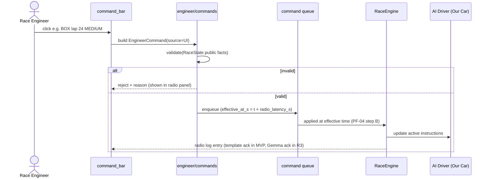

## PF-08 ENGINEER COMMAND BY RADIO (R3)

**Status (2026-10-28): NOT IMPLEMENTED (R3, parked).**

- Done: only the pieces this flow reuses: `engineer/commands.validate()` (HR-07) and the
  PF-07 queue.
- Not implemented: `radio/llm.py`, `radio/gemma_parser.py`, `radio/gemma_driver.py` and
  `ui/radio_panel.py` are stubs; no training data, fine-tuned model or GGUF file exists.
  Tasks: `T-206` (training data), `T-207` (fine-tune), `T-208` (GGUF), `T-200` (LLM
  worker), `T-201` (parser + clarify), `T-203` (radio text input).

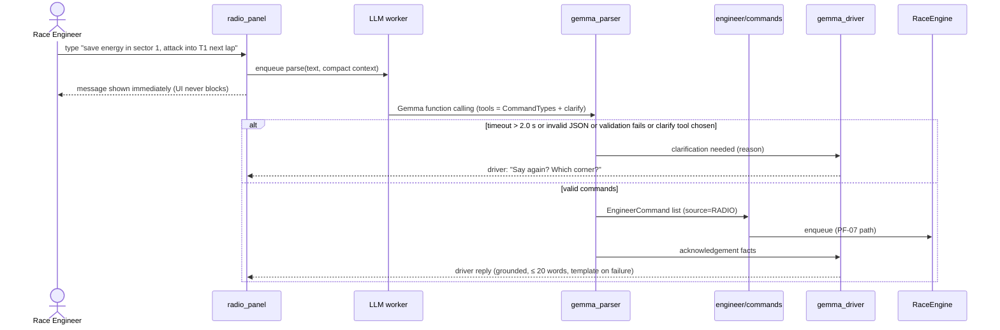

## PF-09 DRIVER UNPROMPTED RADIO (R3)

**Status (2026-10-28): NOT IMPLEMENTED.**

- Done: the radio log in the lite UI shows command acks, alert calls and rejections.
- Not implemented: none of the triggers (low battery before a long straight, tyre wear,
  position change, rain / SC / VSC / incident), the rate limiter or the reply builder.
  The MVP line above ("template replies only, same triggers") is not covered by any R1
  task (`T-076` covers only acks); the Gemma part is `T-202` (R3). Owner to decide where
  the MVP template part goes.

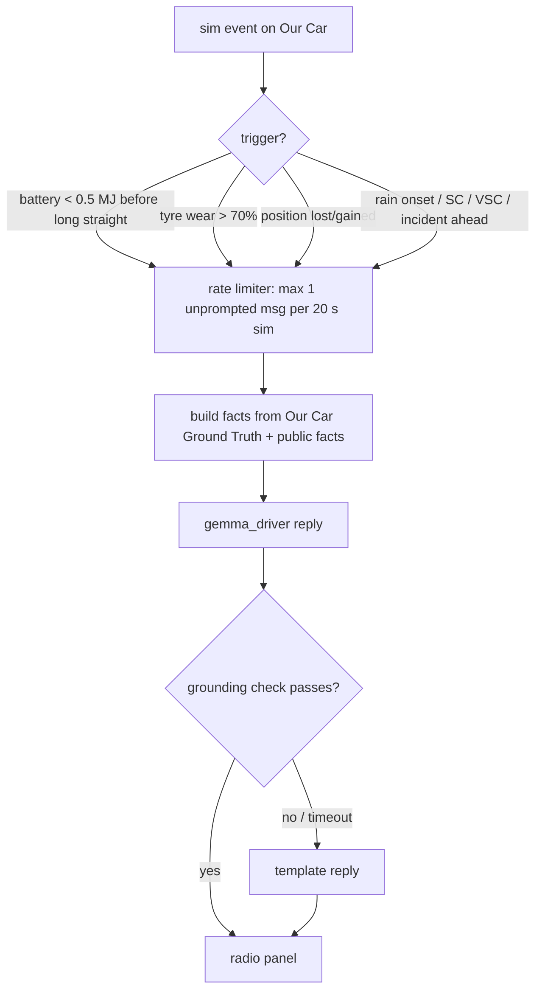

MVP: template replies only, same triggers.

## PF-10 RIVAL STRATEGY DECISION

**Status (2026-10-28): PARTIAL (green-flag, dry-race part done).**

- Done: `race/rival_strategy.py`, every decision tick: in a battle (within
  `battle_gap_s`) own battery against the opponent's Radar Estimate → ATTACK / HOLD /
  DEFEND; otherwise the energy schedule (BALANCED, HARVEST below `low_battery_mj` until
  `recover_battery_mj`, PUSH in the last laps); pit: inside the stop window when the
  tyre is past `wear_threshold`, the planned lap is reached or the car behind threatens
  an undercut, any time at `critical_wear`. Plans per team `strategy_style`. Tested: a
  Rival pits and changes mode unaided (MVP-10) and never reads other cars' Ground Truth.
- Needs refinement: a Rival's HOLD means only "not attacking" (HOLD variant B on main);
  the TRD reads as if it stops overtake attempts: owner decision, variant A is on branch
  `wip/hold-position`. In short races (Race laps < 53) Rivals push and may pit from lap
  1. Strategy values are placeholders (`T-02C`).
- Not implemented: the SC / VSC branch and the weather-crossover branch (`T-062`, which
  needs `T-038`).

Runs per Rival team every decision tick (1.0 s sim).

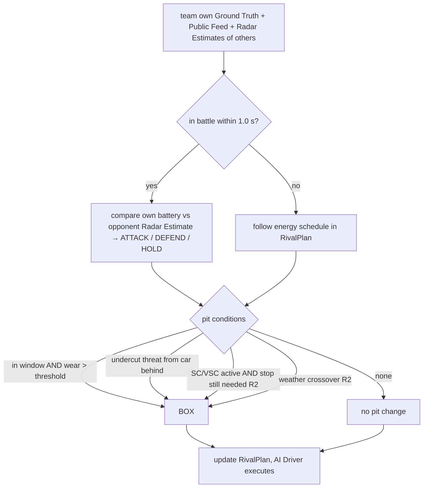

## PF-11 OVERTAKE RESOLUTION

**Status (2026-10-28): DONE, needs refinement.**

- Done: `race/overtake.py`: trigger points (braking zones from the speed profile and
  the overtaking zones), `x` from Δv, Δgrip, Overtake mode, racecraft, ATTACK, DEFEND and
  zone difficulty, `p_pass = sigmoid(x)` on RNG stream `overtake`, swap on success, time
  loss on failure, blue flags, no attempt under Our Car's HOLD_POSITION. About 75
  overtakes per race (seed average).
- Needs refinement: weights are `# PLACEHOLDER` / `GAMEPLAY-TUNED (sprint)` and
  `zone_difficulty.OT1` is `UNKNOWN` (default 2.0 used); overtakes per race are not yet
  compared with the real Suzuka count (`T-02C`).
- Not implemented: contact on a failed attempt → incident (`p_contact`, PF-13, `T-038`);
  the radio trigger when Our Car is involved (PF-09).

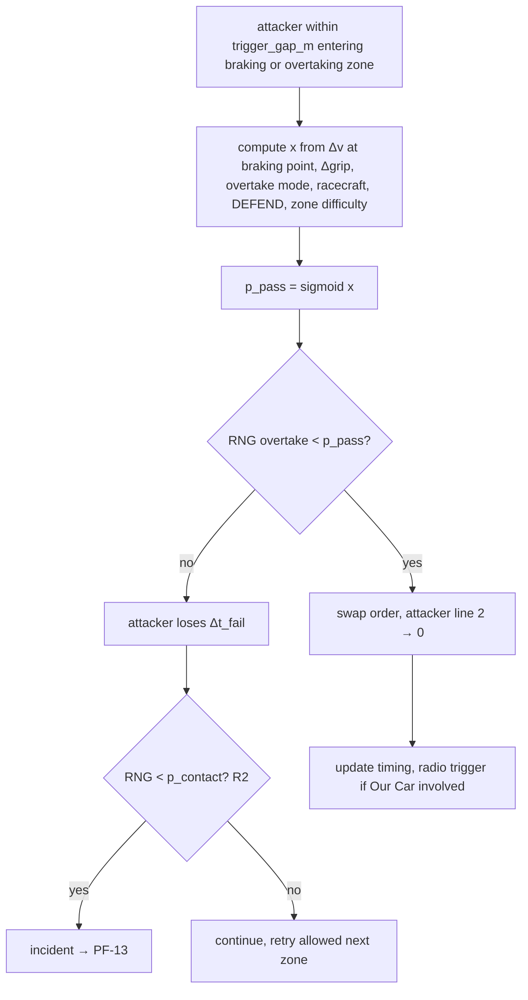

## PF-12 PIT STOP

**Status (2026-10-28): DONE.**

- Done: `race/pit.py` `PitPhase` RUNNING → BOX_PENDING → PIT_LANE_IN → STATIONARY →
  PIT_LANE_OUT → RUNNING, CANCEL_BOX before pit entry, lane speed limit, stop time from
  Normal(mean, sd) plus a slow-stop chance (RNG stream `pit`), new compound with tyre age
  and wear reset (`T-035`, MVP-09 tests).
- Needs refinement: `pit.lane_loss_s` in `suzuka.yaml` is `UNKNOWN` (not read by the pit
  model; listed with the unresolved keys at start-up).
- Not implemented: the cheaper stop under SC / VSC (MVP-13) comes with `T-038` and
  `T-062`.

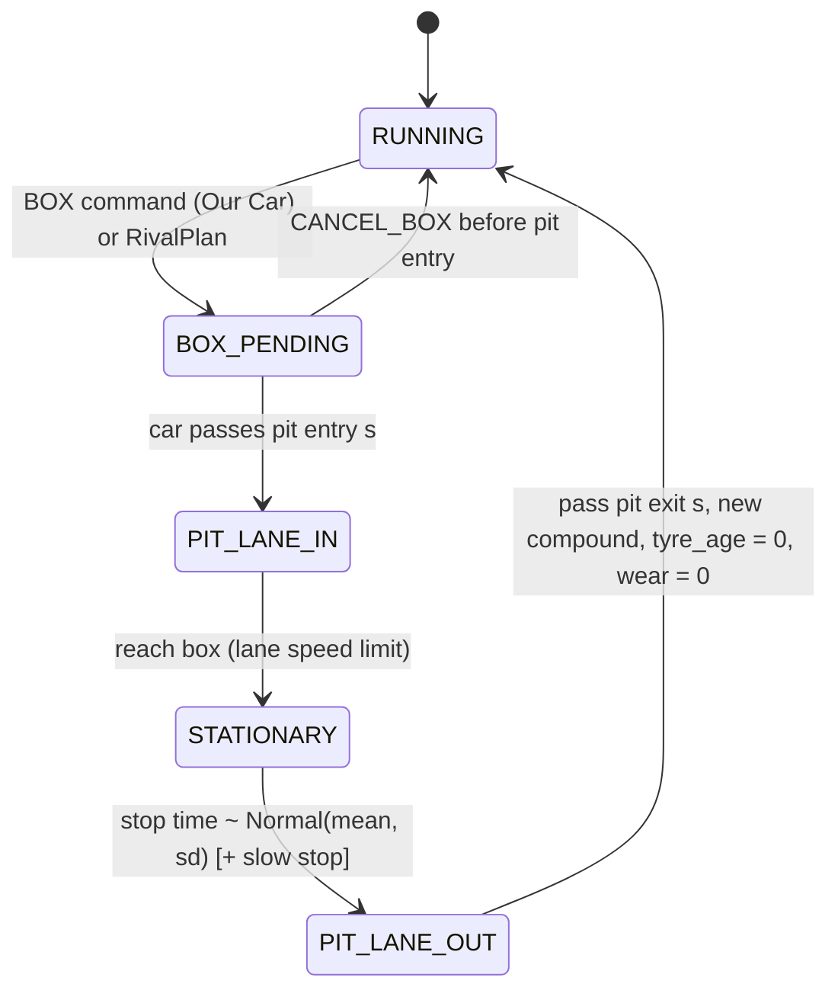

## PF-13 INCIDENT → VSC / SC / RED FLAG (R2)

**Status (2026-10-28): NOT IMPLEMENTED.** The owner moved incidents, VSC and SC into
R1 (`docs/spec/MVP.md`, 2026-10-19), so the "(R2)" in the heading now applies only to the red
flag, track limits and penalties.

- Done: only the inputs: driver mistakes (lock-up, off-track, spin, crash; `T-037`,
  RNG stream `mistakes`) and retirements (crash, out of fuel) in `RaceEngine._events`.
- Not implemented: severity, damage, VSC, Safety Car, restart, red flag, track-limits
  and penalty checks, Decision Point logging. `race/events.py` is a stub;
  `events.incident_rate_per_lap` and `events.sc_share` in `suzuka.yaml` are `UNKNOWN`.
  Tasks: `T-038` (incidents, VSC, SC; MVP-11), `T-102` (red flag, track limits,
  penalties, R2), `T-078` (VSC / SC banners).

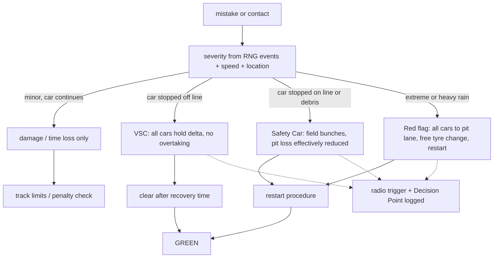

## PF-14 WEATHER CHANGE (R2)

**Status (2026-10-28): PARTIAL (model done, reactions missing).** The owner moved
weather into R1 (`T-039`, DONE), so the "(R2)" in the heading is out of date.

- Done: `race/weather.py`: Markov chain of conditions, track wetness with drying by the
  cars on track, track evolution, grip per compound (the crossover comes from the
  `tyres.yaml` curves, MVP-12 test), lap plans recomputed when grip changes by
  `weather.replan_grip_step`, and a noisy public forecast in
  `EngineerView.weather_public`.
- Needs refinement: the live UI shows neither the weather nor the forecast (`T-078`);
  the setup screen cannot force rain; weather coefficients are placeholders.
- Not implemented: Rival AI boxing at the crossover (`T-062`); Our Car's radio trigger and
  Decision Point logging (PF-09 / PF-16, R3).

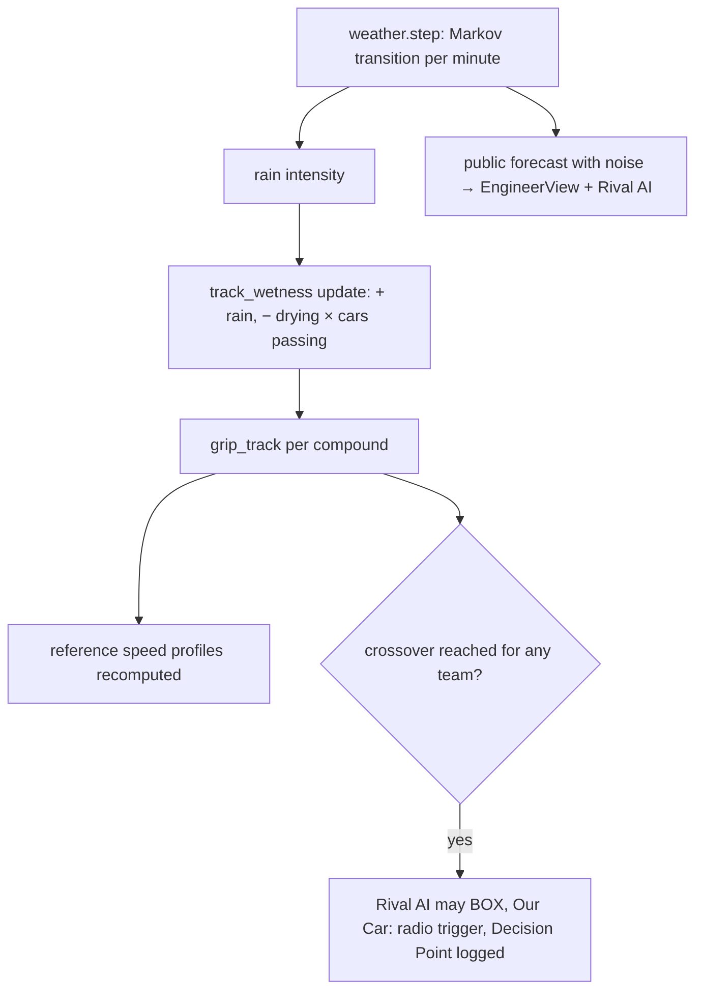

## PF-15 STRATEGY PREDICTOR (R2)

**Status (2026-10-28): NOT IMPLEMENTED (R2, `T-105`).**

- Done: building blocks: Snapshot and fork (`race/snapshot.py`, MVP-06), the fast
  headless engine, Radar Estimates, and paired forks with common seeds in
  `engineer/call_outcome.py` (the same idea at smaller scale).
- Not implemented: `engineer/predictor.py` and `ui/strategy_panel.py` are stubs; no
  candidate plans, forks per plan, pit window or undercut output.

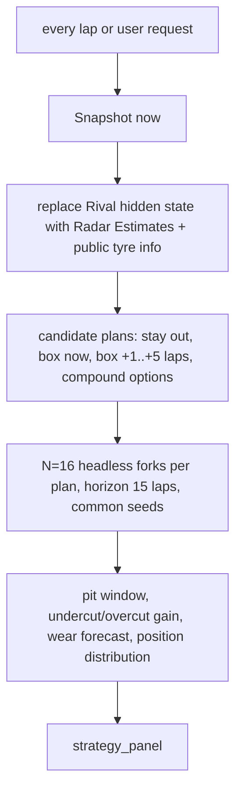

Runs in background worker; never blocks UI or the main sim.

## PF-16 RACE END AND DEBRIEF (R3)

**Status (2026-10-28): NOT IMPLEMENTED (R3, `T-204`, `T-205`); a sprint call summary
stands in.**

- Done: the chequered flag and final classification (headless CLI prints it); the sprint
  call summary (`A-4`) opens at the flag: every alert, the option chosen / ignored /
  expired, the outcome over the next 2 laps, and in Test mode whether the alert was right.
- Not implemented: penalties (`T-102`), Decision Point collection, forks per decision,
  loss and score, the debrief screen with Ground Truth traces. `debrief/scorer.py` and
  `ui/debrief_view.py` are stubs.

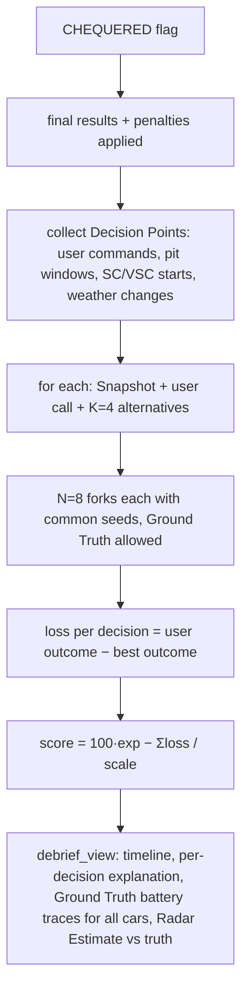

## PF-17 COMPARE MODE — DECISION POINTS (R4)

**Status (2026-10-28): NOT IMPLEMENTED (R4, `T-300`, `T-301`, `T-303`).**

- Done: nothing in this flow. (The S-2 replay viewer, `viewer/`, replays *simulated*
  races, not Real Races.)
- Not implemented: `replay/real_race.py` and `replay/compare.py` are stubs. Without an
  F1TV login FastF1 returns no 2026 data, so the Real Race loader will need the same
  OpenF1 fallback as the track builder (`docs/guides/SETUP.md` section 4).

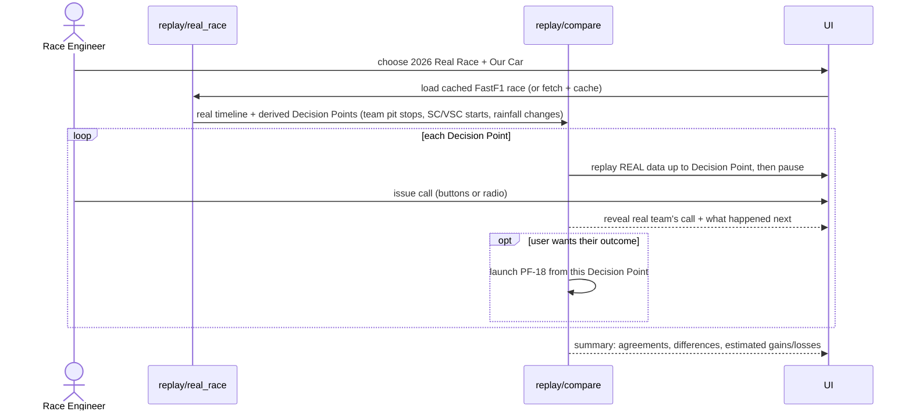

## PF-18 COMPARE MODE — ALTERNATE RACE (R4)

**Status (2026-10-28): NOT IMPLEMENTED (R4, `T-302`, `T-303`).**

- Done: building blocks only: Snapshot / fork, Radar Estimates (step D), Rival Strategy AI.
- Not implemented: initialising a RaceState from a Real Race lap, pace scaling to laps
  L−5..L−1, the side-by-side result.

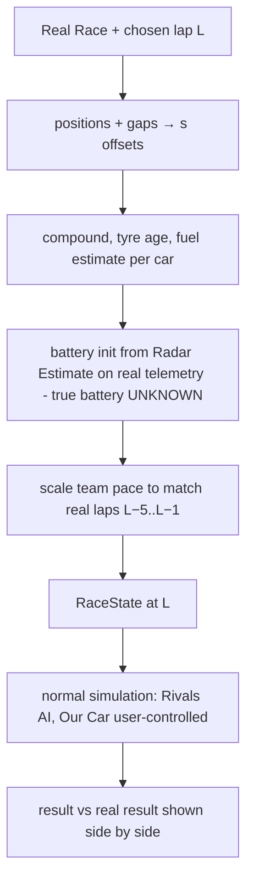

## OPEN ITEMS

| Item | Status |
| --- | --- |
| Overtaking zone and detection point positions per track | Manual entry per track; source documents UNRESOLVED |
| Behaviour when a Real Race has missing telemetry segments | UNRESOLVED (proposed: mark affected Decision Points unavailable) |
| Rate limits and trigger thresholds for unprompted radio | Initial values above; tuning UNRESOLVED |
