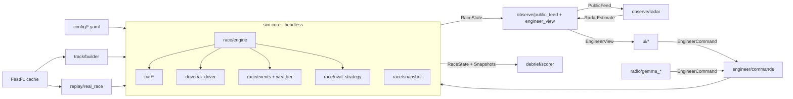

# TRD.md — Pit Wall Race Simulator (2026 Regulations)

## PURPOSE

This document defines HOW `pitwall_sim` is technically implemented: stack, repository layout, modules, data contracts, config schemas, algorithms, threading, performance budgets and tests.

Feature IDs (`F01`–`F20`) and requirement IDs (`FR-*`, `NFR-*`) are defined in `PRD.md`. MVP scope and build order are in `MVP.md`. Runtime sequences are in `PROCESS_FLOW.md`.

## CONTEXT

`pitwall_sim` is a single-user desktop 2D F1 race simulator under the 2026 regulations. The user is the race engineer of one car (Our Car). The simulator holds Ground Truth for all 22 cars, including hidden battery energy. In-race UI sees Our Car's Ground Truth and only the Public Feed for Rivals. Rival battery is shown as a Radar Estimate produced by the Rival Battery Radar estimator (`F11`), a physics model that infers battery energy from speed, throttle and brake.

## ARCHITECTURE PRINCIPLES

| ID | Principle | Consequence |
| --- | --- | --- |
| AP-01 | Headless simulation core | `sim/` has zero imports from `ui/`, `radio/` or PySide6. Full race runs without UI (NFR-02) |
| AP-02 | Deterministic | All randomness from seeded `numpy.random.Generator(PCG64)`; one child stream per subsystem. No wall-clock time in simulation logic (FR-SIM-08) |
| AP-03 | Snapshot everything | All mutable race state lives in `RaceState`; Snapshot = deep copy of `RaceState` + RNG states (`F09`) |
| AP-04 | Information barrier | In-race UI receives only `EngineerView` objects built by `observe/`. `EngineerView` contains no Rival Ground Truth fields (FR-SCR-01) |
| AP-05 | Config over code | Rule numbers, tracks, teams, drivers, calibration coefficients in YAML (FR-SIM-03) |
| AP-06 | LLM never acts directly | Gemma output is converted to `EngineerCommand` and validated before execution (FR-EXT-02) |



## TECHNOLOGY STACK

| Layer | Technology | Version | Use |
| --- | --- | --- | --- |
| Language | Python | 3.13 | All code (owner decision 2026-10-19; 3.11 unavailable on the target machine) |
| Numerics | NumPy | latest 1.x/2.x compatible | Arrays, RNG |
| JIT | Numba | latest compatible | Inner simulation step loop |
| Signal | SciPy | latest | Savitzky-Golay smoothing, interpolation, splines |
| Dataframes | Polars | latest | Real Race data, calibration, logs |
| Storage | Parquet (via Polars + pyarrow), YAML (PyYAML) | — | Caches, logs, config |
| Config validation | pydantic v2 | latest | Typed config models |
| Real data | FastF1; OpenF1 REST API as backup | latest supporting 2026 | Track geometry, Real Races, calibration references. FastF1's live-timing source needs an F1TV login; OpenF1 (free, no auth) is the backup for track geometry (`track/openf1.py`) |
| UI | PySide6 + pyqtgraph | latest | Desktop 2D window, plots, track map |
| LLM runtime | llama-cpp-python | 0.3.36, CPU build only | In-process Gemma inference (target hardware has no GPU) |
| LLM model | Gemma 3 270M instruct (`gemma-3-270m-it`), fine-tuned, GGUF Q8_0 | 270M | Radio parse (`F14`). Fine-tuning is REQUIRED, not optional. Q8_0 preferred: at 270M the size saving of Q4 is negligible and costs accuracy |
| Tests | pytest, pytest-qt, hypothesis | latest | Unit, property, integration, UI tests |
| Quality | ruff, mypy, import-linter | latest | Lint/format, types, architecture contracts |

Exact pinned versions: pinned in `pyproject.toml` (T-001). Runtime: numpy 2.5.4, numba 0.68.0, scipy 1.18.1, polars 2.0.0, pyarrow 26.0.0, fastf1 3.8.3, pyyaml 6.0.3, pydantic 2.14.1, PySide6 6.12.0, pyqtgraph 0.14.0. Dev: pytest 9.1.1, pytest-qt 4.5.0, hypothesis 6.170.1, ruff 0.17.1, mypy 2.4.0, import-linter 2.15, types-PyYAML 6.0.12.20260906. Radio (R3): llama-cpp-python 0.3.36.

## REPOSITORY STRUCTURE

```text
pitwall_sim/
├── CLAUDE.md                       # agent entry point
├── docs/                           # PRD, MVP, TRD, PROCESS_FLOW, UI_DESIGN, TASKS, SETUP, BUILD_PROMPTS
├── pyproject.toml
├── .importlinter                   # contracts sim-headless, ui-info-barrier (SETUP.md section 3)
├── main.py                         # starts the desktop app
├── models/                         # Gemma GGUF (R3), git-ignored
├── config/
│   ├── app.yaml                    # paths, default seed, UI refresh rate, model path
│   ├── rules/
│   │   ├── 2026_pre_miami.yaml     # F03
│   │   └── 2026_post_miami.yaml    # F03
│   ├── grid/
│   │   ├── real_2026.yaml          # F19
│   │   └── fictional.yaml          # F19
│   ├── teams/performance.yaml      # per-team PU, drag, efficiency (F02, FR-SIM-02)
│   ├── tyres.yaml                  # compound coefficients (F02)
│   └── tracks/<track_id>.yaml      # F01 track metadata + zones
├── data/
│   ├── fastf1_cache/               # FastF1 raw cache
│   ├── tracks/<track_id>.parquet   # built track models (F01 output)
│   └── real_races/<year>_<round>/  # Real Race parquet (F17, F18, F20)
├── pitwall_sim/
│   ├── config/
│   │   ├── models.py               # pydantic v2 models per YAML schema
│   │   └── loader.py               # load + validate + report UNRESOLVED keys
│   ├── track/builder.py            # F01
│   ├── car/
│   │   ├── powertrain.py           # F02, F03
│   │   ├── battery.py              # F02, F03
│   │   ├── aero.py                 # F02
│   │   ├── tyres.py                # F02
│   │   ├── fuel.py                 # F02
│   │   ├── speed_profile.py        # F02 reference speed profile (QSS pass)
│   │   └── dirty_air.py            # F02
│   ├── driver/ai_driver.py         # F04
│   ├── race/
│   │   ├── state.py                # RaceState, CarState dataclasses
│   │   ├── engine.py               # F05 main loop
│   │   ├── step_kernel.py          # Numba per-step physics
│   │   ├── overtake.py             # F05 overtake model
│   │   ├── pit.py                  # F05 pit lane
│   │   ├── events.py               # F06
│   │   ├── weather.py              # F07
│   │   ├── rival_strategy.py       # F08
│   │   └── snapshot.py             # F09
│   ├── observe/
│   │   ├── public_feed.py          # F10
│   │   ├── engineer_view.py        # AP-04
│   │   └── radar/                  # F11 (ported from Rival Battery Radar engine/)
│   │       ├── physics.py
│   │       ├── energy.py
│   │       └── battles.py
│   ├── engineer/
│   │   ├── commands.py             # F12 command schema + validator
│   │   └── predictor.py            # F13
│   ├── radio/
│   │   ├── llm.py                  # Gemma loader + worker
│   │   ├── gemma_parser.py         # F14 text → EngineerCommand
│   │   └── gemma_driver.py         # F14 driver replies
│   ├── replay/
│   │   ├── real_race.py            # F17/F18 FastF1 → RealRace
│   │   └── compare.py              # F17, F18
│   ├── debrief/scorer.py           # F16
│   ├── calibration/compare.py      # F20
│   └── ui/
│       ├── window.py               # F15 layout
│       ├── clock.py                # replay clock + speed control
│       ├── timing_tower.py
│       ├── track_map.py
│       ├── telemetry_plot.py
│       ├── radar_panel.py
│       ├── strategy_panel.py
│       ├── radio_panel.py
│       ├── command_bar.py
│       └── debrief_view.py
└── tests/
    ├── unit/
    ├── integration/
    └── ui/
```

## SIMULATION CORE

### Time stepping

| Parameter | Value | Config key |
| --- | --- | --- |
| Physics step `dt` | 0.05 s (20 Hz), fixed | `app.yaml: sim.dt_s` |
| Strategy / AI decision tick | every 1.0 s of sim time | `app.yaml: sim.decision_tick_s` |
| Public Feed rate | 4 Hz | `app.yaml: feed.rate_hz` |
| UI refresh | 10 Hz wall clock | `app.yaml: ui.refresh_hz` |

Car position is distance along the track centre line `s` (metres) plus lateral line index (`0` racing line, `1` defending/inside, `2` overtaking/outside). No 2D lateral dynamics.

### Per-step order (`race/engine.py`)

```text
1. apply queued EngineerCommands whose effective time ≤ t
2. every decision tick: rival_strategy.update(), ai_driver.decide() for all cars
3. weather.step(dt)                      (R2)
4. step_kernel.step(all cars, dt)        → throttle/brake → forces → v, s, battery, tyres, fuel
5. overtake.resolve(pairs in proximity)
6. pit.step()
7. events.step()                         (R2: incidents, SC/VSC, penalties)
8. timing.update()                       → lap, sector, gaps
9. every 1/feed.rate_hz: public_feed.emit()
10. t += dt
```

Implementation (`T-033`, `race/engine.py`): `RaceEngine(RaceSetup)` loads the
race config, builds the kernel arrays and the drivers' first plans, and
`tick()` runs one feed interval (`1 / feed.rate_hz`, 5 steps) with the stages
above in this order (`engine.STAGES`; `engine.trace` records them). Stages 1-3
and 5-9 run once per interval, the kernel (stage 4) runs every physics step of
it: one Python pass per 0.05 s step would cost more than the kernel itself, and
the kernel time-stamps every timing-loop and line crossing within its step, so
timing stays exact. Rival strategy, weather, overtake, pit, events and the
feed are no-op hooks until `T-041`, `T-039`, `T-034`, `T-035`, `T-038`,
`T-050`; commands are queued by `effective_at_s` and passed to
`engine.command_handler` (`T-061` wires them to the AI Driver).

- Standing start: cars at rest in grid order on slots `race_engine.pole_offset_m
  + k · grid_slot_spacing_m` behind the line (lap −1), battery
  `start_battery_fraction` × full, track `fuel_start_kg`, `start_compound`.
- Drivers: one `plan_lap` per (team, compound, instructions, battery, fuel,
  wear) situation, shared by teammates; at each line crossing the deploy level
  is retuned with `CarPlan.relevel` by the change of the Energy Mode target plus
  `energy_feedback_gain` × the lap's miss (no lap prediction). Each decision tick
  `decide` sets line, Overtake (only inside overtaking zones) and boost; at
  boost activation `boost_total_w` records the car's power (post-Miami cap).
- Timing loops in the kernel (`KernelTrack.loops_m`): the track's
  `sector_ends_m`, Overtake detection points and mini-sector loops every
  `race_engine.timing_loop_spacing_m`. Gap to leader = the car's time at its
  latest loop − the first car's time at the same loop and lap; interval = the
  same against the car classified ahead. Sector 1-3 times run line → sector 1
  end → sector 2 end → line. `lap` counts completed laps; lap 1 is timed from
  the start (t = 0). Overtake detection: available when the car passes a
  detection point within `overtake.activation_gap_s` of the previous car to
  pass it.
- Finish: the leader completing `race_laps` shows the chequered flag; every car
  finishes at its next line crossing (lapped cars a lap down) and leaves the
  road. Classification: finished cars by laps then finish time, then running
  cars by distance.
- Measured (Suzuka, 53 laps, 22 cars, 2026-10-24, `T-02A` fit on two cores):
  setup 4.0 s (11 team plans), race 7.0 s. After `T-036`: setup 1.4 s, race 5.8 s
  (compiled speed-profile passes; vectorised decisions; timing only for cars
  that passed a loop; ranks kept as an array; scipy imported lazily). Headless
  CLI: `python -m pitwall_sim.race.engine --headless [--track --rules --grid
  --seed --laps --fuel-kg]` prints the classification and the NFR-02 times
  (exit 0 finished, 1 invalid config, 3 not finished). Open: race laps 103.4-107 s against
  real 92.4 s fastest / 95.8 s median (OpenF1 session 11253): the race energy
  balance (braking harvest ~5.5 MJ/lap, `partial_harvest_max_kw` placeholder),
  fuel (~1.6 kg/lap: the 70 kg placeholder runs out near lap 44; the kernel does
  not stop the ICE at 0 kg) and tyre wear (1.0 by the flag without pit stops,
  `T-035`) need race calibration.

### Step kernel (`race/step_kernel.py`, `T-030`)

Compiled (Numba) fixed-step physics for all cars over parallel arrays:
`KernelTrack` (curvature, Straight Mode / acceleration-zone masks), `KernelGlobals`
(air, Rule Set tapers and caps, structural values), `KernelCars` (per-car team,
power unit, battery, fuel and current-tyre coefficients), `KernelControls`
(throttle, brake, deploy fraction, Overtake, boost, super-clip, tyre management,
grip factor) and `KernelState` (SI: `s_m`, `v_ms`, `lap`, `battery_j`, per-lap
counters, `tyre_wear`, `fuel_kg`, `aero_mode`, `running`, `line_time_s`), built
from config by `kernel_track` / `kernel_globals` / `kernel_cars`.

- `step(dt, …, t_s)`: one step for every running car, same formulas as
  `car/*` (checked by tests against the Python functions): aero mode from zone and
  throttle; friction ellipse; ICE (fuel-flow capped) then MGU-K within zone cap,
  taper, boost cap and the battery's energy this step; throttle scales power;
  brake = fraction of the grip left by the ellipse; speed then capped at the
  corner speed of the point reached (a car cannot corner above its grip; the
  overshoot is the hook for the mistakes model, `T-037`); battery harvest /
  draw / per-lap limits; fuel; tyre wear; timing-line crossing (lap +1, counters
  reset, crossing time interpolated into `line_time_s`).
- `track_speed(dt, v_target, …)`: the AI Driver's actuator: full throttle, part
  throttle solved in power terms, or the brake fraction to reach the target in
  one step.
- `advance(n_steps, dt, t, plans, …, stop_lap)`: `n_steps` steps in one compiled
  call, each car following its `KernelPlans` row (`T-031`): reference speed
  `v_ref` (target = profile speed where the car will be after the step), deploy
  fraction, super-clip, part-throttle harvest and throttle cap at its position;
  an active boost deploys fully and does not clip or harvest. The engine calls it
  once per decision tick (20 steps), because one Python→Numba call costs ~30 µs on
  its own; `stop_lap` ends the call once every running car reaches that lap (lap
  predictions).
- Part-throttle harvest (`T-031`, TRD Battery source "Part throttle"): with
  `part_harvest` set, below full throttle and off the brakes the MGU-K harvests
  `min(partial_harvest_max_kw, P_k_harvest_max)`. At part throttle the ICE's spare
  power covers it (more fuel); the rest, all of it when coasting, comes from the
  car's motion as a retarding force (at most the tyres' longitudinal grip).
  Off by default, so the `T-025` lap-simulation match is unchanged.
- Helpers take scalar arguments only: passing the array `NamedTuple`s into a
  helper (even inlined) touched ~50 reference counts and cost ~0.8 µs per car.

Measured (target class laptop, 2026-10-24, with the T-02A fit running on two
cores): 5.4 µs per 22-car step including speed tracking (budget 20 µs). One car
driven round Suzuka at `sim.dt_s` matches the T-025 lap simulation within
0.005 % (4 MJ battery) and 0.012 % (unlimited energy) (acceptance 0.1 %).

### Longitudinal dynamics (`step_kernel.py`)

Point mass per car:

```text
m · dv/dt = F_drive − F_drag − F_rr − F_brake

F_drag   = ½ · ρ · CdA(aero_mode, dirty_air) · v²
F_rr     = C_rr · (m·g + F_down)
F_down   = ½ · ρ · ClA(aero_mode, dirty_air) · v²
F_drive  = min( η · (P_ice + P_k_deploy) / max(v, v_min),  μ_long · (m·g + F_down) )
m        = m_car_min + m_driver_ballast + m_fuel(t)
```

Owner decisions (round 9, before `T-024`; force laws in `car/dynamics.py`, shared
by the speed profile and the step kernel):

- **Mass**: the FIA minimum (Rule Set `car.min_mass_kg`, 768 kg) includes the
  driver and seat and excludes fuel, so `m_driver_ballast = 0` and
  `m = 768 kg + fuel_kg`.
- **Air density**: `ρ = p / (R_specific · T)`, `R_specific = 287.05 J/(kg·K)`, from
  the track's `air_temp_c` / `air_pressure_hpa` (Suzuka: placeholders 20 °C /
  1013 hPa → 1.204 kg/m³), computed once per race; `T-039` weather may update it.
  Missing either → `app.yaml: physics.rho_fallback` (1.20, STRUCTURAL). The Radar
  keeps its own `radar.rho` (1.18).
- **Rolling resistance**: `C_rr` per compound in `tyres.yaml` (`c_rr`, 0.015,
  `# PLACEHOLDER: calibrate`); the Radar keeps `radar.c_rr` (0.012).
- **Grip**: one friction ellipse for traction, braking and cornering,
  `(a_long / (μ_long·N/m))² + (a_lat / (μ_lat·N/m))² ≤ 1`, `N = m·g + F_down`,
  `μ_long = μ_lat · long_grip_ratio` (per team, 1.0, `# PLACEHOLDER: calibrate`).
  Traction is also power-limited (`η·P / max(v, v_min)`); braking is
  grip-limited only, with no separate brake cap unless `T-026` shows braking
  zones too short.
- **`v_min`**: `app.yaml: physics.v_min_ms` (1.0 m/s, STRUCTURAL); the standing
  start uses the same formula.
- **Start fuel**: track `fuel_start_kg` (Suzuka 70 kg, `# PLACEHOLDER: calibrate`
  in `T-026`).

Corner speed limit at track point with curvature `κ`:

```text
v_corner² = μ_lat · m · g / ( m·κ − μ_lat · ½ · ρ · ClA )      (if denominator ≤ 0 → no limit)
μ_lat = μ_tyre(compound, wear, temp) · grip_track(wetness, evolution) · dirty_air_factor
```

Reference speed profile per car: quasi-steady-state forward/backward pass over `v_corner(s)` with available acceleration and braking. Recomputed once per lap per car, and immediately on weather state change or tyre change. AI Driver tracks this profile (`F04`).

Implementation (`T-024`, `car/speed_profile.py`): `v_ref = min(v_corner,
v_accel, v_brake)` on the track model grid. `v_corner` uses the aero mode at
each point (Straight Mode in `straight_mode_allowed` zones). Forward pass: full
throttle, ICE at full power capped by the fuel energy-flow limit, MGU-K at
`deploy_fraction` of the zone cap / taper allowance, friction ellipse. Backward
pass: Corner Mode, braking on the grip the ellipse leaves, drag and rolling
helping. Each pass starts at the slowest point and runs two laps, so the
result is the periodic flying lap. On a constant-radius corner the car settles
just below `v_corner`, where the ellipse's remaining longitudinal grip balances
the resistance. `reference_params(...)` assembles the inputs from config.

First Suzuka profile (uncalibrated placeholders, SOFT, 70 kg fuel): 97.5 s
pre-Miami, 98.6 s post-Miami (real 2026 pole 88.8 s), 345 km/h top speed.
Curvature-overshoot check (known issue): every speed minimum lies at a corner;
none at the Straight Mode zone ends where a straight/corner-join overshoot
would show. Against the real fastest lap (OpenF1 car_data): the T16/T17
minima are a real chicane (curvature changes sign between them), the T6 minimum
at 1563 m matches the real 1556 m; the hairpin (T11) shows two minima 32 m
apart where the real car has one (radius dips 20 → 30 → 19 m), a harmless
smoothing artefact. Absolute corner speeds are low (hairpin 59 vs 74 km/h,
Esses ~120 vs ~210 km/h) because grip / downforce are uncalibrated (`T-026`).

Performance: one profile takes ~37 ms in plain Python (5 807 points). A full
race recomputes 22 cars × 53 laps ≈ 1 166 profiles ≈ 43 s, over the 10 s
headless budget (NFR-02), so the passes are compiled with Numba (done in
`T-036`, on scalar arguments; a test checks them against the Python formulas):
one profile now takes 1.4 ms.

### Powertrain (`car/powertrain.py`)

```text
P_ice       = throttle · P_ice_max[team]
P_k_allowed = min( zone_cap(s, rule_set),
                   P_k_max · taper(v, mode) ,
                   boost_cap(P_total_at_activation, P_ice, rule_set) )   # post-Miami only
boost_cap   = P_total_at_activation + boost_net_cap − P_ice   # total ≤ activation total + 150 kW
P_k_deploy  = min( P_k_allowed · deploy_fraction(energy_mode, s, driver_state),
                   battery.available_power() )
```

Taper functions (linear between knees; values from Rule Set):

```text
taper_boost(v)    = 1                         if v ≤ boost_taper_start
                  = (boost_taper_end − v)/(boost_taper_end − boost_taper_start)   in between
                  = 0                         if v ≥ boost_taper_end
taper_overtake(v) = same with overtake_taper_start / overtake_taper_end
```

Overtake mode is available to a car when its gap to the car ahead at the detection point is ≤ `overtake.activation_gap_s`; it grants `overtake.extra_energy_mj_per_lap` usable only inside overtaking zones.

Implementation (`T-021`): `powertrain_params(rules, team)` converts once to SI
(`PowertrainParams`, a `NamedTuple` so Numba-compiled code can take it); the team
MGU-K limit is clamped to the Rule Set `power.p_k_max_kw`. Zone caps read the
track's `acceleration_zone` tag through `track/zones.zone_mask` (zones with
`s_end_m < s_start_m` wrap past s = 0). `deploy_fraction` (T-031) and battery
available power (T-022) are inputs. `boost_active` is decided by the AI Driver
(T-031, see AI DRIVER boost rules).

### Battery (`car/battery.py`)

```text
E(t+dt) = clip( E(t) + (P_harvest − P_k_deploy / η_discharge) · dt , 0 , E_usable_max )
```

| Harvest source | Rule |
| --- | --- |
| Braking | `P_harvest = min(P_k_harvest_max, brake_power · harvest_share)` |
| Super-clipping | At full throttle near straight end, when driver chooses or battery strategy requires: `P_harvest = superclip_power_kw`, wheel power reduced accordingly |
| Part throttle | `P_harvest = min(partial_harvest_max_kw, …)` |

Per-lap limits tracked by counters reset at the timing line: `harvest_mj_this_lap ≤ harvest_max_mj_per_lap (+ overtake extra while Overtake is active)`, where the limit is resolved per race (see `config/tracks/<track_id>.yaml`). `deploy_max_mj_per_lap` is `null` in both Rule Sets: deployment has no per-lap cap and is limited only by the battery window and the harvest limit. Energy counter reset at formation lap start when `energy_counter_reset: formation_lap_start` (post-Miami); no reset when `none` (pre-Miami).

Implementation (`T-022`): `battery_params(rules, team, harvest_limit_mj)` (SI,
`BatteryParams` `NamedTuple`, Numba-compatible) with the race harvest limit from
`resolve_harvest_limit_mj`. `P_k_harvest_max` is the Rule Set `power.p_k_max_kw`
(the MGU-K limit applies to harvest and deploy). `η_discharge`, `harvest_share`
and `partial_harvest_max_kw` are per-team `# PLACEHOLDER: calibrate` values in
`config/teams/performance.yaml` (`battery_discharge_efficiency`,
`brake_harvest_share`, `partial_harvest_max_kw`). `step()` stores harvest up to
the per-lap allowance and the window's free room (measured before the draw),
draws `P_k_deploy · dt / η_discharge` up to the stored energy (including this
step's harvest) and any per-lap deploy allowance, so `0 ≤ E ≤ E_usable_max` and
both counters stay within their limits for any inputs. Counters are in J of
stored / drawn battery energy; `CarState` holds them in MJ.

### Active aero (`car/aero.py`)

- `STRAIGHT_MODE` on zones tagged `straight_mode_allowed` in track config, when throttle ≥ threshold. Otherwise `CORNER_MODE`.
- Per team: `CdA_straight`, `CdA_corner`, `ClA_straight`, `ClA_corner` from `teams/performance.yaml`.
- Threshold: `app.yaml: aero.straight_mode_throttle_min` (STRUCTURAL 0.95; the TRD gives no value). Modes are `AERO_MODES` int codes (`T-023`).

### Tyres (`car/tyres.py`)

Load sensitivity (owner round 14, T-02A Change 1): `μ(N) = μ · (N / N_ref)^(−k_load)`
with `N = m g + F_down`, on lateral and longitudinal grip (friction ellipse
unchanged); `tyres.yaml load_sensitivity`: `n_ref_n` = static load at the
calibration mass (STRUCTURAL, (768 + 5 kg) × g), `k_load` shared by all teams
(`# PLACEHOLDER: calibrate`, fitted in T-02A stage 1 within 0.05–0.30). The corner
speed has no closed form: `dynamics.corner_speed_ms` solves `m|κ|v² = μ(N)·N` by
Newton in `v²` from a 150 m/s cap (convex, one root; `k_load = 0` keeps the closed
form). Grip no longer grows linearly with downforce, so the medium-fast corners
are no longer near the `k = 0` singularity (~124 m radius with the provisional
coefficients). The speed profile (Python and compiled), the lap simulation and
the step kernel all use it.

```text
μ_tyre = μ_base[compound] · f_temp(T_tyre) · f_wear(wear)
d(wear)/dt   = k_wear[compound] · track.abrasiveness · (|F_long| + |F_lat|) · v / norm  · driver_mgmt_factor
f_wear(w)    = 1 − a·w                      for w < cliff_w
             = 1 − a·cliff_w − b·(w − cliff_w)  for w ≥ cliff_w
dT/dt        = heat_gain · energy_into_tyre − cool_rate · (T − T_ambient_track)
```

Compounds: `SOFT`, `MEDIUM`, `HARD`, `INTERMEDIATE`, `WET`. All coefficients in `tyres.yaml`; initial values: UNKNOWN — set by calibration (`F20`) against FastF1 stint lap-time degradation.
MVP MAY fix `T_tyre` at optimal (see `MVP.md`).

Implementation (`T-023`): MVP holds `T_tyre` at `t_optimal_c`, so `f_temp = 1`
(temperature model in `T-100`); wetness / `wet_grip_factor` come with weather
(`T-039`). `norm` is `tyres.yaml: wear_norm_j` (STRUCTURAL 3.0e9 J: ~30 laps of
~90 MJ tyre work wear a `k_wear = 1` tyre to ~0.9, so `k_wear` carries the
calibration). Wear is capped at 1; `f_wear` never below 0.

### Fuel (`car/fuel.py`)

`m_fuel` decreases with `P_ice` integrated over time, using `fuel_energy_density` and ICE efficiency from Rule Set / team config. Start fuel mass per track: UNKNOWN — calibrate so race ends with ≥ 0 kg.

Implementation (`T-023`): fuel power = `P_ice / ice_efficiency`, capped at the
Rule Set `fuel.max_fuel_energy_flow_mj_per_h` (3000 MJ/h ≈ 833 kW, which caps
ICE power at `ice_efficiency ×` that); mass rate = fuel power /
`fuel_energy_density_mj_per_kg` (per-team `# PLACEHOLDER: calibrate`, 43 MJ/kg;
the TRD gives no value).

### Dirty air and slipstream (`car/dirty_air.py`)

```text
gap_m = distance to car ahead along s
if gap_m < dirty_air.range_m:
    f = 1 − gap_m / dirty_air.range_m
    ClA ← ClA · (1 − dirty_air.downforce_loss_max · f)      # corners
    CdA ← CdA · (1 − slipstream.drag_reduction_max · f)      # straights
```

Coefficients: UNKNOWN initial values, calibrated (`F20`).

Implementation (`T-032`): `car/dirty_air.py` holds the compiled scalars
(`wake_factor`, `downforce_scale`, `drag_scale`) and `gaps_ahead_m`: the distance
along the road to the nearest running car ahead, lap-independent (a lapped car
counts), `inf` when alone. The step kernel computes the gaps at the start of
`track_speed` and of `step` (stored in `KernelState.gap_ahead_m`) and scales both
aero modes' `CdA` and `ClA`, so the corner-speed cap and the drag follow the wake.
Coefficients in `app.yaml` `dirty_air` (`range_m` 60, `downforce_loss_max` 0.25)
and `slipstream` (`drag_reduction_max` 0.3), all `# PLACEHOLDER: calibrate (F20)`.
22-car step with gaps: 9.2 µs (was 5.4 µs; budget 20 µs; measured with the
`T-02A` fit on two cores).

## AI DRIVER (`driver/ai_driver.py`)

Inputs: own `CarState`, reference speed profile, active `EngineerCommand`s (Our Car) or `RivalPlan` (Rivals), local traffic (cars within 200 m).
Outputs per step: `throttle ∈ [0,1]`, `brake ∈ [0,1]`, `line ∈ {0,1,2}`, `use_overtake: bool`, `superclip: bool`.

| Behaviour | Logic |
| --- | --- |
| Speed tracking | P-controller on `v_ref(s) − v` with braking point from backward pass |
| Energy Mode `PUSH` | Deploy max allowed everywhere; no voluntary super-clip. Owner round 14: the deploy level fills the energy-spreading order (`car/deploy_allocation.py`, slowest exits first) |
| Energy Mode `BALANCED` | Target net battery change ≈ 0 per lap; deploy prioritised in acceleration zones |
| Energy Mode `HARVEST` | Target net battery gain per lap `harvest_target_mj`; lift-and-coast + super-clip enabled |
| `DEFEND` | Line 1 into target corner (or next braking zone), deploy reserved for next straight |
| `ATTACK` | Use Overtake mode when available, line 2 into braking zone |
| `HOLD_POSITION` | No overtake attempts; keep ≥ 0.8 s gap |
| `LET_TEAMMATE_BY` | Yield on next straight |
| `PUSH_LAP` | Increase grip usage margin for N laps; higher tyre wear |
| `MANAGE_TYRES` | Lower grip usage margin; `driver_mgmt_factor < 1` |
| Boost (owner decision round 7; `T-031`) | A driver action within engineer limits. `PUSH`: boost allowed on every acceleration-zone exit. `BALANCED`: only when attacking (gap ahead ≤ 1.0 s) or defending (car behind ≤ 1.0 s). `HARVEST`: never. `ATTACK` / `DEFEND` force boost on the next acceleration zone if battery energy allows. Never activate when battery energy < a reserve in `app.yaml` (structural default 0.3 MJ, added in `T-031`). At activation, record total power for the post-Miami boost cap |
| Mistakes (R1, `T-037`) | Per-corner probability from driver skill, tyre wear, wetness → lock-up / off-track / spin / crash |

Driver skill per driver in grid config: `skill_pace`, `skill_racecraft`, `skill_consistency` ∈ [0,1].

Mistakes (`T-037`; `app.yaml: mistakes`, every value `# PLACEHOLDER: calibrate`
until `T-02C`): each time a car on track passes a corner of the track config,
`p = base_p_per_corner × (1 + consistency_gain (1 − skill_consistency)) ×
(1 + wear_gain × tyre_wear) × (1 + wet_gain × track_wetness)`, drawn on RNG
stream `mistakes` (HR-04), outcome by `kind_shares`. A lock-up, off-track or spin
keeps `speed_factor` of the car's speed (the time lost follows from the drive;
a lock-up also adds `lock_up_wear`); a crash retires the car (`crash at Tn`;
`T-038` turns it into an incident). Events: `RaceEngine.mistakes`
(`MistakeEvent`: time, car, kind, corner), kept in snapshots. Each car's next
corner is tracked by race distance, so a tick costs one comparison for all
cars (≈ 0.6 s per race). With the placeholders: ~3 mistakes per car per race,
~0.35 crashes per race. The kernel lifts (plan throttle cap) only at or above
`ai_driver.lift_min_speed_share` × `v_ref`, so a spun car pulls away from a
lift point. To keep NFR-02 with the new stage, T-037 also compiled the overtake
trigger check (`overtake._close_hits`), the corner check (`step_kernel.reached`)
and the classification (`step_kernel.race_order`, equal to the former
`lexsort`), solves the deploy level by Illinois regula falsi (same 0.002
resolution or 2 kJ, 109 instead of 154 lap predictions at setup) and draws the
Public Feed noise in blocks of 256 emissions. Headless race 9.6-9.8 s on the
development laptop under background load.

Implementation (`T-031`, `driver/ai_driver.py`; settings in `app.yaml`
`ai_driver`, STRUCTURAL unless owner-sourced):

- Per lap, `plan_lap` builds the car's `KernelPlans` row. Reference speed = `T-024`
  profile at `grip_margin` (PUSH_LAP `push_lap_grip_margin`, MANAGE_TYRES
  `manage_tyres_grip_margin`). Deploy fraction from one **deploy level** in
  [0, 2]: 0 → 1 fills the acceleration zones, 1 → 2 the rest of the lap. The level
  is the highest whose predicted lap (the step kernel, one car, from the current
  battery, fuel and wear; bisection) ends at the Energy Mode's battery target:
  PUSH spends down to `boost_reserve_mj`, BALANCED ends level, HARVEST gains
  `harvest_target_mj_per_lap`. Deploying everything everywhere would empty the
  battery mid-lap and be slower, so PUSH means "as much as the lap's energy
  allows". HARVEST adds super-clip over the last `superclip_zone_m` of each
  acceleration zone and lift and coast (`lift_coast_m` before braking zones that
  drop at least `lift_coast_min_drop_kmh`, only on the fast approach);
  SET_LIFT_COAST lifts in any mode. Part-throttle / coasting harvest is on in
  every mode. LET_TEAMMATE_BY deploys nothing in the acceleration zones.
- `EnergyBalance`: after each lap the target moves by `energy_feedback_gain` ×
  the last lap's miss (traffic, boost and Overtake spend energy the plan did not
  predict).
- Per decision tick, `decide` sets the line (2 within `boost_gap_s` of the car
  ahead when allowed to attack, 1 with a car that close behind or when letting a
  teammate by), Overtake mode (available, permitted, attacking) and boost (owner
  round 7 rules above). HOLD_POSITION and LET_TEAMMATE_BY never attack;
  `mgmt_factor` is `push_lap_mgmt_factor` / `manage_tyres_mgmt_factor`.
- Measured (Suzuka, Mercedes, MEDIUM, 40 kg fuel, 2 MJ battery, flying lap):
  PUSH 100.45 s (−1.70 MJ), BALANCED 102.45 s (+0.00 MJ), HARVEST 103.48 s
  (+0.51 MJ). A plan takes ~0.2 s (profile ~40 ms + ~13 predicted laps), so the
  engine (`T-033`) re-plans on instruction / tyre changes and corrects with
  `EnergyBalance` in between, not every car every lap.

## OVERTAKE MODEL (`race/overtake.py`)

Triggered when attacker is within `overtake.trigger_gap_m` of defender entering a braking zone or overtaking zone.

```text
x = w1·Δv_braking_point + w2·Δgrip + w3·overtake_mode_active + w4·(racecraft_att − racecraft_def)
    − w5·defender_DEFEND_instruction − w6·zone_difficulty[track]
p_pass = sigmoid(x)
outcome ~ Bernoulli(p_pass) using RNG stream "overtake"
on fail: attacker loses Δt_fail; contact probability p_contact(x) → incident (R2)
```

Weights `w1..w6` and `zone_difficulty`: UNKNOWN initial values, calibrated so simulated overtakes per race match real 2026 counts per track (`F20`).

Implementation (`T-034`, `race/overtake.py`; `app.yaml` `overtake`):

- No driving through: the step kernel holds every car at least
  `overtake.follow_gap_m` (STRUCTURAL 6 m) behind the car ahead on the road, at
  most at its speed (`KernelState.ahead_idx`); passes happen only here.
- Trigger points: overtaking-zone starts (difficulty `zone_difficulty[zone]`, or
  `zone_difficulty_default` while UNKNOWN) and braking-zone starts of the speed
  profile whose drop is at least `braking_trigger_min_drop_kmh`
  (`braking_zone_difficulty`). Suzuka: OT1 plus 13 braking zones.
- Each feed interval, every car within `trigger_gap_m` of the car ahead that
  passed a trigger point attempts: `Δv` = speed difference then (m/s), `Δgrip` =
  tyre friction difference (`step_kernel.grip_mu`), Overtake active, racecraft
  difference (grid `skill_racecraft`), defender's DEFEND, difficulty; draw on RNG
  stream `overtake` (`race/snapshot.make_rngs`, HR-04). Success swaps the two
  cars' positions and speeds (PF-11; attacker back to line 0); failure sets the
  attacker back `v · fail_time_loss_s` metres (never past the car behind);
  timing-loop pointers are resynchronised. A car a lap ahead passes without an
  attempt (blue flag). Swaps across the timing line are skipped. Contact on a
  failed attempt (`p_contact`) is `T-038`.
- Every weight, the trigger gap, the difficulties and `fail_time_loss_s` are
  `# PLACEHOLDER: calibrate (F20)` (`overtake.PLACEHOLDER_KEYS`, logged at race
  start). With them a 53-lap Suzuka race has ~980 attempts and ~400 passes
  (+95 blue-flag passes): far more than real races, to calibrate in F20.

## PIT LANE (`race/pit.py`)

- Pit entry/exit positions and `pit_lane_loss_s` from track config.
- Stationary time ~ Normal(`pit.stop_mean_s`, `pit.stop_sd_s`), clipped at `pit.stop_min_s`; slow-stop probability `pit.slow_stop_p`. Values: UNKNOWN — calibrate from FastF1 2026 pit data.
- Pit lane speed limit from track config.
- Under SC/VSC, effective loss reduced by simulation (cars on track slower), not by a constant.

Implementation (`T-035`, `race/pit.py`): the PF-12 state machine per car
(`PitLane`: `request_box` / `cancel_box`, `step` each feed interval; engine
`box()` / `cancel_box()`, `T-061` wires the commands). The lane follows the
track's `s` from `pit.entry_s_m` to `pit.exit_s_m` (crossing the line, so laps
count as usual); `KernelState.in_pit` cars are invisible to cars on track and
skip racing decisions. The kernel limits them to `lane_speed_kmh` over
`pit.limit_length_m` (track config, centred on the box; SOURCE: (OpenF1
`lane_duration` median − mean stop) × lane speed, Suzuka 473 m) and brakes them
on the entry road at `app.yaml pit.entry_decel_ms2` (STRUCTURAL 20 m/s²) to
reach the limit line at the limit. At the box (`pit.box_fraction` of the lane)
the car is stationary (not `running`) for a stop time drawn on RNG stream `pit`:
`app.yaml pit` `stop_mean_s` 3.01, `stop_sd_s` 0.67, `stop_min_s` 2.0,
`slow_stop_p` 0.05, `slow_stop_extra_s` 3.59 (SOURCE: `python -m
pitwall_sim.calibration.pit_stops --track suzuka`, OpenF1 `stop_duration` of 20
stops, 2026 Japanese GP). At the exit the engine fits the new compound
(`step_kernel.set_compound`), wear 0, tyre age 0, and re-plans the car. Suzuka:
a stop costs 24.1 s against no stop (MultiViewer `pitLoss.normal` 22.8 s); the
entry-to-exit time is ~30 s (OpenF1 lane median 24.3 s covers only the timed
lane). `lane_loss_s` stays UNKNOWN: the loss emerges from the drive.

## RACE EVENTS (`race/events.py`) — R2

| Event | Trigger | Effect |
| --- | --- | --- |
| Incident / crash | AI Driver mistake or overtake contact | Car damage (pace loss), DNF, or debris |
| VSC | Incident severity `minor` with car stopped off line | All cars target delta time `vsc_delta`; no overtaking |
| Safety Car | Severity `major` or debris on line | Field bunches behind SC; lapped cars rule per config; restart procedure |
| Red flag | Severity `extreme` or heavy rain | Cars to pit lane; tyre change allowed; restart |
| Track limits | Car exceeds track edge at tagged corners | Races and sprints: offence count per car; offence = `race.track_limits_warnings_before_penalty` (3) shows the black-and-white flag; every later offence gives a 5 s time penalty. Qualifying: the lap time is deleted, no penalty |
| Time penalty | Track limits, collision responsibility | +5 s / +10 s applied at pit stop or race end |
| DNF | Severe crash or reliability failure (`reliability_dnf_p_per_race[team]`) | Car retired |

All probabilities and procedure parameters in track config and `rules/*.yaml`. Initial values: UNKNOWN — calibrate against 2026 SC/VSC frequency per track.

Hackathon H4 implementation (simplified T-038; `app.yaml: race_events`, values
hand-set for the demo, owner Round 16: VSC delta 1.35, SC pace 1.40, car 5.5 m):
an AI Driver CRASH retires the car and stops it on the racing line with
`crash_on_line_p` (RNG `events`) → Safety Car, else off the line → VSC (a car on
the line during a VSC upgrades it). `TrackStatus` in `RaceState`; the kernel
scales each car's reference speed by `KernelControls.speed_scale` outside the pit
lane: VSC = 1 / `vsc_delta_factor` for `vsc_duration_s`; SC = 1 / `sc_pace_factor`
for the queue, `sc_catch_up_scale` for a car more than `sc_gap_m` behind the car
ahead; no overtakes under either. The SC ends `sc_laps` leader laps after it was
deployed (the last one `SC_IN_THIS_LAP`). Rivals' SC / VSC pit branch at
deployment: box if the planned stop is at most `rival_box_window_laps` away and at
least `rival_box_min_laps_left` laps remain. `demo.scripted_sc_lap` (or
`RaceSetup.scripted_sc_lap`) forces an SC when the leader starts that lap.

## WEATHER (`race/weather.py`) — R2

- State: `DRY`, `DAMP`, `WET`, `HEAVY_WET`; Markov transitions per minute from track config `weather.transition_matrix`.
- `track_wetness ∈ [0,1]` rises with rain intensity, falls with drying rate × cars passing.
- `grip_track = f(wetness, compound)`; slick vs intermediate vs wet crossover emerges from per-compound grip curves in `tyres.yaml`.
- `track_evolution`: grip increases with laps completed in dry, coefficient per track.
- Rain forecast for strategy: noisy forecast of next 10 min given to all teams equally.

Implementation (`T-039`, `race/weather.py`; dynamics in `app.yaml: weather`,
statistics in the track config, every number `# PLACEHOLDER: calibrate` except
the TRD's per-minute step and 10-min horizon):

- A race is rainy with `rain_p_per_race` (`RaceSetup.rain`: `auto` / `dry` /
  `rain`); only a rainy race runs the per-minute Markov chain over DRY, DAMP,
  WET, HEAVY_WET (`transition_matrix`). RNG stream `weather` only (HR-04).
- `dw/dt = wetting × intensity(condition) × (1 − w) − (drying + car_drying ×
  share of cars on track) × w`, per minute; `track_evolution` += `evolution_per_lap`
  × (1 − w) per leader lap, washed away at `evolution_wash_per_min` × w.
- Grip of a compound = dry grip × (1 + (`wet_grip_factor` − 1) × w) × (1 +
  evolution), set as each car's kernel `grip_factor`; the crossover is where two
  compounds' curves cross (`weather.crossover_wetness`; Suzuka placeholders:
  SOFT → INTERMEDIATE at w ≈ 0.8), never a coded wetness. Car plans are rebuilt
  when a car's grip rounded to `replan_grip_step` (2 %) moves (PF-14).
- Forecast: chance of rain within `forecast_horizon_s` from the chain + Gaussian
  noise `forecast_noise_sd`, clipped, renewed every step, published in
  `EngineerView.weather_public` (the Rival AI reads it in `T-062`).
- Evaluated at decision ticks; the grip update is skipped while wetness and
  evolution stand still (dry headless race 9.5-9.9 s).
- Not in T-039: the post-Miami wet-race ERS deployment reduction (a Rule Set
  value, owner decision) and the reactions to the crossover (`T-062`).

## RIVAL STRATEGY AI (`race/rival_strategy.py`)

Each Rival team has a `RivalPlan`: target stop laps, compounds, energy mode schedule, attack/defend thresholds.
Inputs: the team's own Ground Truth + Public Feed for other cars (FR-SIM-04). It MUST NOT read other cars' Ground Truth battery.

Logic per decision tick:

```text
- energy: if battle within 1.0 s → ATTACK/DEFEND rules using own battery vs Radar Estimate of opponent
- pit: if lap in window and (tyre wear > threshold or undercut threat or SC active) → box
- weather: if crossover condition met → box for appropriate compound
- MAY use strategy predictor (F13) Monte Carlo with small sample count (≤ 8 forks)
```

Team aggression and strategy style per team in `teams/performance.yaml`.

Implementation (`T-041`; thresholds are STRUCTURAL defaults in `app.yaml:
rival_strategy`, to calibrate in `T-02C`):

- Plans (`make_plans`, RNG stream `rival_strategy`): one stop at
  `stop_fraction[strategy_style]` of the race distance, the second car of a team
  `teammate_offset_laps` later, ± `stop_jitter_laps`; MEDIUM → HARD (HARD →
  MEDIUM when starting on HARD). A race too short for a stop window plans none.
  Team style / aggression placeholders fall back to BALANCED / 0.5. Our Car
  (`RaceSetup.our_driver_id`) has no plan.
- Energy: in a battle (gap ≤ `battle_gap_s` to the car ahead) ATTACK when own
  battery exceeds the opponent's Radar Estimate by `attack_margin_mj × (1.5 −
  aggression)`, else HOLD; with a car behind within the gap DEFEND unless its
  estimate exceeds own battery by more than `defend_margin_mj × (0.5 +
  aggression)`. An estimate with confidence 0 (or no opponent) counts as level
  with own battery. Energy Mode: BALANCED; HARVEST once the battery at the line
  is below `low_battery_mj`, until it is back to `recover_battery_mj` at the line
  (the battery swings by MJs within a lap, so the line value decides; at most one
  change per lap); PUSH in the last `push_final_laps`.
- Pit: never in the last `no_stop_last_laps` or in the pit lane; at
  `critical_wear` at any time; otherwise the planned stop from `window_laps`
  before the planned lap once the lap is reached, wear ≥ `wear_threshold` or the
  car behind is within `undercut_gap_s`. SC / VSC and weather reactions:
  `T-062`. The predictor (F13) is not used in R1.
- HR-03: inputs are the Rival's own Ground Truth (battery, battery at the line,
  tyre wear, laps), public positions and gaps, and the other cars' Radar
  Estimates (`RadarBank.energies()`). Test: changing another car's true battery
  leaves every other car's decision unchanged; changing its Radar Estimate
  changes the chasing car's decision.
- Speed (owner round 15, NFR-02): the engine runs one compiled call per decision
  tick (`battle_inputs`, `decide_book` over a `RivalBook` of all Rivals) after
  bringing the compiled Radar up to date; `decide` is the scalar reference and a
  test checks they agree. Only changed instructions are applied; a change of
  Energy Mode re-shapes the car's plan (cache by team, compound, plan key, fuel
  per 10 kg, wear per 0.2). Measured: full headless race 8.3-8.9 s on the
  development laptop (Radar ≈ 0.6 s, Rival decisions ≈ 0.7 s).
- Pit lane (found in `T-041`): on the limiter the plan's lift-and-coast throttle
  cap, super-clip and part-throttle harvest do not apply (a HARVEST lift point
  at the pit box held a car at a standstill).

## SNAPSHOT AND DETERMINISM (`race/snapshot.py`) — F09

- `Snapshot = {race_state: RaceState (deep copy of all numpy arrays and dataclasses), rng_states: dict[str, bytes], t: float, command_log: list[EngineerCommand]}`.
- `save(t) → Snapshot`, `restore(snapshot) → RaceState`, `fork(snapshot, commands) → RaceEngine`.
- Automatic Snapshots every lap at timing line and at every Decision Point.
- Determinism test: two runs with the same seed and command log MUST produce identical `RaceState.hash()` (SHA-256 of all state arrays) at every lap.
- RNG streams: `overtake`, `mistakes`, `events`, `weather`, `pit`, `feed_noise`, `rival_strategy`, `predictor`. Each derived from master seed with `SeedSequence.spawn`.

Implementation (`T-040`): `make_rngs(seed)` spawns the streams in the order
above (PCG64). `RaceEngine.snapshot()` / `snapshot.save` deep-copy the engine's
mutable state (kernel state and controls, per-car tyres, timing, pit and
overtake state with their RNG streams, instructions, plans in use, command
queue) and share by reference what never changes in a race (config, track
model, compiled track arrays, immutable driver plans), so a snapshot is small
enough to take every lap; the kernel plan arrays are rebuilt on restore.
`Snapshot` also carries the public `RaceState`, `rng_states` (pickled
bit-generator states) and the command log (applied, then queued).
`snapshot.restore` returns a new engine and leaves the snapshot reusable;
`snapshot.fork(snapshot, commands)` restores and queues `commands`. The engine
takes an automatic snapshot each time the leader completes a lap
(`engine.auto_snapshots`, PF-04). `RaceState.hash()`: SHA-256 over the mirrored
car arrays, time, ids, flag, weather and timing. Tests: same seed + same
commands give identical hashes at every lap and at the flag; `restore(save(t))`
finishes identically to the uninterrupted run (state hash and result).

## PUBLIC FEED (`observe/public_feed.py`) — F10

Emits per Rival car, at 4 Hz, with noise and dropout:

| Field | Noise | Dropout |
| --- | --- | --- |
| `speed_kmh` | Gaussian σ = `feed.speed_noise_kmh` | frame dropped with p = `feed.drop_p` |
| `throttle_pct` | quantised to 1%, σ = `feed.throttle_noise_pct` | same frame |
| `brake` | boolean | same frame |
| `gear` | exact | same frame |
| `x_m`, `y_m` | σ = `feed.position_noise_m` | same frame |
| `distance_m` | derived | same frame |

Public timing (exact, no noise): position, gap to leader, interval, last lap, sector times, tyre compound, tyre age (laps), pit stop count, penalties, flags, race control messages.

Defaults (structural decision, mirror FastF1 characteristics): `rate_hz: 4`, `drop_p: 0.05`, `speed_noise_kmh: 0.5`, `throttle_noise_pct: 1.0`, `position_noise_m: 1.0`.

Implementation (`T-050`, `observe/public_feed.py`): the race engine emits once
per tick (one feed interval) for every running car on track except Our Car
(`RaceSetup.our_driver_id`); noise and drops on RNG stream `feed_noise`. Gears are
not simulated: the frame's gear is the band of `feed.gear_upshift_kmh`
(STRUCTURAL) the true speed falls in. `x_m`, `y_m` = centre-line point + noise;
`distance_m` = lap distance + the along-track part of that noise. Frames are kept
for `feed.window_s` (STRUCTURAL 120 s) as per-tick columns of true values and
drawn noise, decoded into `PublicFeedFrame`s on read (`frames`, `recent`), so a
headless race pays ~0.5 s for the feed. Public timing (`TimingState`) adds
`compound`, `tyre_age_laps`, `pit_stops`, `penalties_s`. Measured over a 2-lap
race: rate, drop rate and noise sigmas within 10 % of config.

## RIVAL BATTERY RADAR (`observe/radar/`) — F11

Port of the existing Rival Battery Radar estimator (`engine/physics.py`, `engine/energy.py`, `engine/battles.py`).

Algorithm summary (restated so this TRD is self-contained):

```text
1. resample feed to 10 Hz, Savitzky-Golay smooth speed (window 7, order 2), accel = d(speed)/dt
2. P_wheel = m·a·v + ½·ρ·CdA·v³ + C_rr·m·g·v
3. P_elec = P_wheel/η − P_ICE
4. CdA fitted per car per aero mode by least squares on full-throttle straight-start samples
5. classify each sample: DEPLOY | CLIP | HARVEST | LIFT | CRUISE
6. integrate energy, clamp to [0, E_usable_max]
7. re-anchor energy ≈ 0 at each CLIP event on a long straight
8. confidence decreases with time since last anchor and missing-sample share
```

Contract: input `PublicFeedFrame[]` for one Rival; output `RadarEstimate`.
Radar constants MUST use the Radar's own config (`config/app.yaml: radar.*`), NOT the simulator's true team values, so the estimate carries realistic model error.
Starting values from the Rival Battery Radar spec (owner decision 2026-10-19, round 2; finalised in `T-051`): `mass_kg` 800, `p_ice_kw` 400, `p_elec_max_kw` 350, `e_max_mj` 4.0, `eta` 0.92, `rho` 1.18, `c_rr` 0.012, `min_confidence` 0.5 (estimates and alerts below it are shown greyed). CdA has no constant: it is fitted (step 4). `confidence_half_life_s` (step 8) is not in the spec and is set in `T-051`.
Runs incrementally in a worker (`QThread`) during live play; batch mode in headless runs.

Implementation (`T-051`, `observe/radar/`; no existing Radar code was found, so it
follows the algorithm above): `physics.py` (Savitzky-Golay weights from numpy,
resampling, wheel and electric power), `energy.py` (`RadarEstimator`: incremental
`update(frames)`, `estimate_batch` for headless runs; `RadarEstimate`). Frames
come from `observe/frames.py`; the import-linter contract `radar-feed-only`
forbids the Radar any import of `race`, `car` or `driver`. Inputs: feed frames,
the public Straight Mode zones (aero mode), lap length and feed rate, and
`radar.*` only. Details and STRUCTURAL settings: step 4 fits CdA on full-throttle
samples in Straight Mode zones between `fit_min_speed_kmh` 180 and
`fit_max_speed_kmh` 280 assuming full deployment (corner mode falls back to that
fit); step 5 thresholds `full_throttle_pct` 98, `lift_throttle_pct` 10,
`state_threshold_kw` 50; step 6 braking harvest = wheel braking power up to
`p_elec_max`; step 7 re-anchors after `anchor_min_s` 1 s of CLIP in a Straight
Mode zone; start energy `start_energy_mj` 4.0; step 8 confidence =
0.5^(time since anchor / `confidence_half_life_s`) × received-frame share over
`missing_window_s` 10 s, 0 until a CdA fit exists. Before a car's first anchor
the estimate is the race-start prior (owner, sprint day 5): battery assumed full
(`start_energy_mj`) with weight `start_prior_confidence` 0.5 on that confidence,
the decay counted from the car's first feed frame; the first anchor replaces it
(weight 1). `RadarEstimate.prior` marks it; alerts show "assumed full at start".
(Sprint day 4 had no prior: unknown until the first anchor.) The Rival
Strategy AI does not read the prior (`RadarBank.energies(with_prior=False)`): an
unanchored car still counts as level with its own battery, so rival behaviour
and overtakes per race are unchanged by it (read with the prior, overtakes rose
from 75 to 128 per race).
`confidence_half_life_s` = 300 s (owner, sprint day 4; 120 s SET in `T-051`): on the sim the error grows only slowly after an anchor (MAE
1.1 → 1.45 MJ over minutes), so the half-life is a display choice: an estimate
two minutes past its anchor falls below `min_confidence` 0.5 and is greyed.
Measured on the sim (3 laps, 22 cars): MAE 1.3 MJ, bias -0.8 MJ, p90 2.5 MJ. The
main error: the sim's BALANCED drivers deploy a partial level on the straights
where the Radar assumes full deployment, so the fitted CdA is ~1.7 m² (true
~0.75) and deployment is overestimated; T-02C (race calibration) revisits it.

## ENGINEER COMMANDS (`engineer/commands.py`) — F12

```python
@dataclass(frozen=True)
class EngineerCommand:
    command_id: str            # uuid4
    issued_at_s: float         # sim time
    source: Literal["UI", "RADIO"]
    type: CommandType
    params: dict               # validated per type
    effective_at_s: float      # issued_at_s + radio_latency_s (config, default 1.0)
```

| `CommandType` | `params` | Validation |
| --- | --- | --- |
| `SET_ENERGY_MODE` | `mode: PUSH\|BALANCED\|HARVEST` | — |
| `SET_OVERTAKE_PERMISSION` | `allowed: bool`, `lap: int\|None`, `zone_id: str\|None` | zone exists on track |
| `SET_LIFT_COAST` | `enabled: bool`, `zone_ids: list[str]\|None` | zones exist |
| `BOX` | `lap: int`, `compound: Compound` | lap ≥ current lap; compound available; rule-legal |
| `CANCEL_BOX` | — | box pending and car not past pit entry |
| `DEFEND` | `corner_id: str\|None` | corner exists |
| `ATTACK` | — | — |
| `HOLD_POSITION` | — | — |
| `LET_TEAMMATE_BY` | — | teammate within 2.0 s behind |
| `PUSH_LAP` | `laps: int (1..5)` | — |
| `MANAGE_TYRES` | `enabled: bool` | — |

SC/VSC/weather reactions use `BOX` with appropriate compound (FR-CTRL-06).
Invalid commands are rejected with a reason string shown in UI and used in radio clarification.

Implementation (`T-060`): `validate(type, params, CommandContext, EngineerConfig)`
checks every parameter (unknown or missing keys, types, ranges, the table's
rules) against public facts only (`CommandContext`: Our Car's lap, pit state and
teammate gap, the track's zones, overtaking zones and corners, the fittable
compounds) and returns normalised parameters or a reason; it never raises.
`make_command` adds a uuid4 and `effective_at_s`; `CommandQueue` releases
commands in `effective_at_s` order (ties in issue order). The TRD numbers live
in `app.yaml: engineer` (`let_teammate_by_gap_s` 2.0, `push_lap_max_laps` 5).
Wiring (`T-061`): `RaceEngine.command_context()` gives the public facts for Our
Car (`RaceSetup.our_driver_id`); applied commands act on Our Car only:
`SET_ENERGY_MODE`, `MANAGE_TYRES` (on/off; clears PUSH_LAP) and `HOLD_POSITION`
(clears ATTACK) last until changed; `PUSH_LAP n` for n laps; owner, sprint day
5: `DEFEND corner` from that corner until the threat clears (the car behind at
the call is more than `engineer.defend_clear_gap_s` 1.0 s back, or has passed
us), at most `engineer.call_max_laps` 2 laps, inside line all the way and deploy
kept for the straights (`DriverInstructions.keep_deploy`: acceleration zones
only); `ATTACK` until a completed pass, HOLD / DEFEND / LET_TEAMMATE_BY, or 2
laps, driving in PUSH (the previous Energy Mode comes back after, unless the
engineer set one meanwhile) at the PUSH_LAP grip margin
(`DriverInstructions.follow_close`: stays in the tow through the corners) with
Overtake mode when available. The Rival Strategy AI's own attack / defend flags
do not set `follow_close` / `keep_deploy`, so races without engineer calls are
unchanged; `LET_TEAMMATE_BY` until the teammate is ahead
(public order); `BOX lap, compound` requests the stop once Our Car is on that
lap, `CANCEL_BOX` drops the plan and cancels before the pit entry;
`SET_OVERTAKE_PERMISSION allowed [lap] [zone]` adds a rule for that lap and / or
overtaking zone, the latest matching rule wins at each decision tick;
`SET_LIFT_COAST enabled [zone_ids]` lifts before braking zones, only inside the
listed zones when given (`DriverInstructions.lift_zones`, part of the plan).
Command state is engine state, so snapshots and forks keep it.

## STRATEGY PREDICTOR (`engineer/predictor.py`) — F13 (R2)

- Input: current Snapshot, Our Car Ground Truth, Public Feed + Radar Estimates for Rivals.
- Method: fork the Snapshot with Rival hidden states REPLACED by Radar Estimates (so the predictor never uses Rival Ground Truth); run `predictor.n_samples` (default 16) headless forks per candidate plan for `predictor.horizon_laps` (default 15).
- Outputs: `PitWindow(start_lap, end_lap)`, `undercut_gain_s` vs car ahead, `overcut_gain_s`, tyre wear forecast per lap, predicted finishing position distribution per plan.
- Runs in a background `QThread`; recomputed every lap or on demand.

## TWO-WAY RADIO (`radio/`) — F14 (R3)

| Item | Value |
| --- | --- |
| Runtime | `llama-cpp-python` 0.3.36, CPU build only, in-process, model loaded at app start + one warm-up prompt |
| Model | Gemma 3 270M instruct (`radio.model_variant: gemma-3-270m-it`), fine-tuned by this project, GGUF Q8_0 preferred (owner decision 2026-10-19, round 2) |
| Model path | `app.yaml: radio.model_path` → `models/gemma-3-270m-it-pitwall.gguf` (output of `T-208`) |
| Context | 2048 tokens |
| Threading | One `QThread` worker with a FIFO queue; UI never blocks (NFR-04) |

A 270M model is far too small for reliable zero-shot function calling, so three
measures are REQUIRED rather than optional (owner decision 2026-10-19):

| ID | Measure | Task |
| --- | --- | --- |
| RAD-01 | Fine-tune on generated engineer-phrase → `EngineerCommand` pairs | `T-206`, `T-207`, `T-208` |
| RAD-02 | Forced JSON-schema output via a llama.cpp GBNF grammar, one grammar per `CommandType` union — the model cannot emit anything but a valid command object | `T-201` |
| RAD-03 | Deterministic keyword pre-parser ahead of the model; unambiguous phrases ("box box box", "push", "harvest") never reach the LLM | `T-201` |

Driver replies are template-generated (`T-202`). The model MAY only rephrase a
template; it MUST NOT originate facts. This keeps `test_radio_grounding`
satisfiable with a 270M model.

### Engineer text → command (`gemma_parser.py`)

```text
input: engineer text + compact context (lap, position, gaps ±2 cars, Our Car energy, tyre, corner/zone ids list)
model: function calling with one tool per CommandType (schemas above) + tool `clarify(question)`
output: list[EngineerCommand] or clarify
validation: JSON-schema check + commands.validate(); any failure → clarify
timeout: radio.parse_timeout_s (default 2.0) → driver reply "Say again?" and no command
```

### Driver replies (`gemma_driver.py`)

```text
triggers: command acknowledgement, clarification, unprompted events
          (battery < 0.5 MJ on straight approach, tyre wear > 70%, lost/gained position, rain onset, SC)
facts passed: Our Car Ground Truth subset + Public Feed facts only
constraints: ≤ 20 words, one line, temperature 0.5, max_tokens 48, stop on newline
grounding check: every number and driver code in reply MUST appear in passed facts; on failure use template reply
fallback: template reply after radio.reply_timeout_s (default 1.5)
```

## REAL RACE REPLAY AND COMPARE (`replay/`) — F17, F18 (R4)

### Data loaded from FastF1 (`real_race.py`)

| Data | FastF1 source |
| --- | --- |
| Laps, positions, lap times, compounds, tyre life, pit in/out | `session.laps` |
| Car telemetry (speed, throttle, brake, gear, X, Y) | `session.laps.pick_drivers(...).get_telemetry()` / `session.car_data`, `session.pos_data` |
| Safety car, VSC, flags | `session.race_control_messages`, `session.track_status` |
| Weather | `session.weather_data` |
| Results | `session.results` |

Cached to `data/real_races/<year>_<round>/*.parquet`. Available races: those published by FastF1 for 2026. FastF1's live-timing source needs an F1TV login, so Real Race replay (R4) may need the same OpenF1 fallback as the track builder (`track/openf1.py`); OpenF1 also serves laps, car data, stints, pit stops, race control and weather.

### Decision Points mode (F17)

Decision Points derived from Real Race: every pit stop of Our Car's team, every SC/VSC start, every `Rainfall` change in weather data.
Replay shows real data (not simulated) up to each Decision Point; user issues commands; then reveal real call + outcome. User's alternative outcome MAY be estimated by launching F18 from that point.

### Alternate Race mode (F18)

```text
init RaceState at chosen lap L from Real Race:
  positions, gaps → s offsets; compound + tyre age; fuel from lap fraction;
  battery: UNKNOWN in real data → initialise from Radar Estimate run on real telemetry (Our Car included)
  car pace: per-team performance scaled so simulated lap times match real laps L−5..L−1
then: all Rivals AI-controlled; Our Car controlled by user; race continues as normal simulation
```

## DEBRIEF AND SCORING (`debrief/scorer.py`) — F16 (R3)

```text
Decision Points = every user command + every pit window lap + every SC/VSC start + every weather change
for each Decision Point d:
    S = Snapshot at d
    candidates = user's actual call + K alternative calls (from command type set, K = debrief.k_alternatives, default 4)
    for each candidate c: outcome[c] = mean over N seeds of finishing time/position from fork(S, c)
         (common random numbers: same seed set for all candidates; N = debrief.n_seeds, default 8)
    best = argmin outcome
    loss_d = outcome[user] − outcome[best]
score = 100 · exp(−Σ loss_d / debrief.score_scale_s)
```

Debrief uses Ground Truth (allowed after race end). Runs in background with progress bar.

## CALIBRATION (`calibration/compare.py`) — F20

Owner round 14 (T-02A): the default deploy policy is the energy-spreading one
(`deploy_policy.settle_spread`, Change 2): the full-throttle runs of the speed
profile (split at the timing line) are ranked by entry speed, slowest first
(`car/deploy_allocation.py`), and funded in that order along a planned battery
path (start + expected harvest − planned deployment, capped at the window) that
stays above `PLAN_FLOOR_J` (STRUCTURAL 0.2 MJ) until the line and ends at the
target (qualifying: 0); super-clip at the acceleration-zone ends as in T-028,
its amount chosen for the fastest lap. The T-028 policy stays as `anywhere`.
Plausibility (STRUCTURAL, `calibration`): peak lateral ≤ 5.5 g, peak braking ≤
6.0 g, Esses (T3–T6) minimum speeds at most 15 km/h above the real median; the fit
report carries them and the pole team's battery every 250 m. The centre line is
the penalized fit (`track_builder.centre_line_fit: penalized`, λ 5000) for the
refit; Straight Mode zones SM1/SM2 and OT1 follow its auto-tagged straights.

| Check | Reference | Pass |
| --- | --- | --- |
| Lap time | Fastest 2026 qualifying lap per track (OpenF1 `/laps`; owner OK before `T-025`, FastF1 needs an F1TV login) | within 2% (NFR-06) |
| Speed trace | Same lap, speed vs distance (OpenF1 `/car_data`, ~3.7 Hz, mapped to s through `/location`) | RMSE ≤ `calibration.speed_rmse_kmh` (default 12) |
| Tyre degradation | Real stint lap-time slope per compound | within ±30% |
| Overtakes per race | Real 2026 position changes on track (excluding pit cycles) | within ±30% |
| SC/VSC frequency | 2026 races per track (historical if only one race) | qualitative |

Outputs a calibration report per track to `data/calibration/<track_id>.parquet` and a summary table.

Implementation (`T-025`): `python -m pitwall_sim.calibration.compare --track <id>`
simulates every team's car (`--team` for one) over one flying lap under the
reference's qualifying conditions: the Rule Set in force on the reference date
(latest `effective_from` not after it; `--rules` overrides), SOFT tyres, a full
battery, the Rule Set qualifying harvest limit, the track's `quali_fuel_kg`
(Suzuka 5 kg, PLACEHOLDER; owner round 10). The lap simulation (`car/lap_sim.py`) steps
metre by metre under the speed profile's corner and braking caps: full throttle
with ICE plus the MGU-K power the battery can supply, part throttle where the
cap binds, braking with MGU-K harvest; battery, counters and fuel integrated
with the T-022/T-023 functions. With unlimited energy it equals the speed
profile exactly. Deployment is greedy (whenever accelerating); the energy
strategy is `T-031`. Pass thresholds: `calibration.lap_time_tolerance` (0.02),
`calibration.speed_rmse_kmh` (12).

First Suzuka run (2026-10-19, all coefficients still placeholders, identical
per team): reference 88.778 s (OpenF1 session 11249, car 12, 2026-03-28,
`2026_pre_miami`); every team 101.968 s, +14.86 %, speed RMSE 55.2 km/h. The
4 MJ battery is empty by T7 (1 855 m) with greedy deployment, worth ~5.9 s vs
the energy-unlimited profile; corner speeds are low because grip and downforce
are uncalibrated. Both are `T-026` work.

Calibration (`T-026`, owner round 10; `python -m pitwall_sim.calibration.fit
--track <id> [--dry-run]`):

- **Targets**: each team's fastest lap of the reference qualifying session (the
  better of its two drivers; drivers matched to teams by car number on the
  grid). Acceptance: every team within `lap_time_tolerance` (2 %) and
  `speed_rmse_kmh` (12) of its own target, simulated team order within
  `max_order_error` (±2) places of the real one; MVP-02 = the pole team within
  2 % of the pole lap.
- **Conditions**: qualifying: track `quali_fuel_kg`, full battery, SOFT,
  wear 0, Rule Set qualifying harvest limit, no dirty air.
- **Deploy policy** (`calibration/deploy_policy.py`, harness only, reusable by
  `T-031` for PUSH). Default since `T-028` (owner decision (c)): deploy anywhere
  at full throttle within the Rule Set caps (pre-Miami has no zone restriction;
  post-Miami allows 250 kW outside acceleration zones); harvest under braking;
  if the lap is energy-limited (the lap simulation reports the deployment the
  battery could not supply, `unmet_deploy_j`), super-clip at the end of every
  acceleration zone, at most that shortfall and the harvest allowance left after
  braking, the amount chosen for the fastest lap (bounded 1-D search) and shared
  by zone length. Mercedes on the provisional coefficients: 88.240 s with 1.41 MJ
  clipped over 490 m, 4.81 MJ harvested, 8.81 MJ drawn, top speed 330 km/h
  (real 321). `compare --deploy zones` keeps the T-026 policy (deploy only in
  acceleration zones, lap energy split by zone length, clip only if the battery
  would run empty before the last zone); `--deploy greedy` uses no plan. The
  literal "clip the whole allowance" reading was rejected: with zones-only
  deployment it wasted energy (95.03 s vs 88.72 s).
- **Stage 1** (shared): SOFT `mu_base` and the default `long_grip_ratio`, fitted
  to the top-5 teams' average lap and mean speed RMSE (same tyres for everyone).
  A shared aero set is fitted alongside only to keep placeholder aero from
  distorting the grip; it seeds stage 2 and is used for teams without a
  reference (fictional grid: neutral, `pu_power_scale` 1.0).
- **Stage 2** (per team): `cla_corner`, `cda_straight`, `cda_corner`,
  `pu_power_scale`, fitted to the team's own lap with grip fixed.
- **Method**: Powell on bound-normalised parameters, objective
  `(Δt / tol)² + (RMSE / limit)²`; bounds in `app.yaml: calibration.bounds`
  (physical justification next to each). A value ending on a bound is reported
  (model, not number, is wrong); bounds are never widened. The config is
  rewritten (comments kept, lines tagged `# CALIBRATED T-026 <track> (bounds …)`)
  only when every acceptance check passes; otherwise exit 3, stop and report.
- `pu_power_scale` multiplies the team's `p_ice_max_kw` (`powertrain_params`).

Suzuka fit, 2026-10-19 (accepted PROVISIONALLY by the owner, round 11: RMSE limit
relaxed to `calibration.speed_rmse_kmh_provisional` = 20 km/h, values written with
`# CALIBRATED-PROVISIONAL (T-026, RMSE limit relaxed)`, bound hits in
`docs/results/CALIBRATION_NOTES.md`; `fit --provisional`; follow-ups `T-028` super-clip,
`T-029` pooled-lap geometry, `T-02A` final calibration at 12 km/h): every team's lap within
0.12 % of its target (MVP-02 lap-time condition met: Mercedes 88.771 vs
88.778 s) and the simulated team order equal to the real one, but speed RMSE
17.2-19.8 km/h for every team (target ≤ 12). On bounds: `cda_straight` (1.0,
all teams), `mu_base_soft` (2.2), `pu_power_scale` (1.03, seven teams).
Diagnosis:

- Reference-data fixes made during T-026: the OpenF1 location → s mapping now
  follows the path (`landmarks.project_path_to_s`), because nearest-point
  projection jumped branches at Suzuka's figure-eight bridge; and frozen or
  out-of-range `car_data` (≥ 3 identical samples, throttle/brake > 100: e.g.
  7 s at 130R in the pole lap) is dropped (`compare.valid_car_samples`).
- No timing offset between `car_data` and `location` (RMSE is lowest at 0 s lag).
- Straights: `cda_straight` pinned at its upper bound means the model has more
  straight-line power than the real cars (real top speed 321 vs 335 km/h). In
  2026 the real cars are energy-limited on the straights (super-clipping); the
  calibration lap harvests only ~1.6 MJ and its policy never super-clips, so drag
  stands in for missing energy management. Not fixable by coefficients.
- Fast corners (Esses, Degner, Spoon) are 40-70 km/h too slow: the single-lap
  3.9 Hz geometry gives Esses radii of 48-64 m. Pooling all 11 teams' fastest
  laps (3 m bins) opens them to 66-77 m and fixes the Esses speeds, but a free
  Mercedes refit on that geometry still ends at RMSE 20.8 km/h with
  `mu_base_soft` and `cda_straight` on bounds, so geometry alone is not enough.
- Pole team greedy vs policy deploy: 88.316 s vs 88.771 s. Corner minimum speed
  sim vs real (pole team): hairpin 71.4 vs 74.0 km/h, Spoon 156.6 vs 168.0 km/h,
  130R 328.8 km/h vs no valid real sample (frozen data removed).

## CONFIG SCHEMAS

### `config/app.yaml`

```yaml
paths: {fastf1_cache, tracks, real_races, calibration, runs}
sim: {dt_s: 0.05, decision_tick_s: 1.0, default_seed: 42}
feed: {rate_hz: 4, drop_p: 0.05, speed_noise_kmh: 0.5,
       throttle_noise_pct: 1.0, position_noise_m: 1.0}
ui:
  window_title: "We Are Racing, Not Testing"   # product name
  refresh_hz: 10
  fallback_palette: ["#RRGGBB", ...]           # used when a team has no color_hex
radar: {resample_hz: 10, savgol_window: 7, savgol_order: 2,
        mass_kg: 800, p_ice_kw: 400, p_elec_max_kw: 350, e_max_mj: 4.0,
        eta: 0.92, rho: 1.18, c_rr: 0.012, min_confidence: 0.5,
        confidence_half_life_s: 120}   # Radar spec starting values; finalised in T-051
track_builder: {resample_m: 1.0, length_tolerance: 0.01,   # T-010 acceptance values
                max_closure_gap_m: 50.0, smoothing_rms_m: 1.0,
                straight_max_curvature_per_m: 0.002, straight_min_length_m: 200.0,  # structural
                normalize_length: true}   # scale to official_length_m (owner round 6)
openf1: {base_url, max_requests_per_s: 3, max_requests_per_min: 30, timeout_s}
multiviewer: {base_url}                     # corner positions for track configs (T-011)
predictor: {n_samples: 16, horizon_laps: 15}
debrief: {k_alternatives: 4, n_seeds: 8, score_scale_s: 20}
radio: {model_path: "models/gemma-3-270m-it-pitwall.gguf",
        model_variant: "gemma-3-270m-it", radio_latency_s: 1.0,
        parse_timeout_s: 2.0, reply_timeout_s: 1.5}
calibration: {speed_rmse_kmh: 12}
```

`radar.*` constants are the Radar's OWN model constants and MUST stay different
from the simulator's true team values (see RIVAL BATTERY RADAR).

### `config/rules/<rule_set>.yaml`

```yaml
rule_set_id: 2026_post_miami          # or 2026_pre_miami
effective_from: "2026-05-03"          # Miami GP; pre_miami: season start
power:
  p_ice_max_kw_nominal: 400
  p_k_max_kw: 350
  zone_caps_kw:                       # post-Miami: by zone tag; pre-Miami: single value
    acceleration_zone: 350
    other: 250
  boost_net_cap_kw: 150               # post-Miami only; null for pre-Miami
  boost_taper_start_kmh: 290           # both Rule Sets (no Miami change announced)
  boost_taper_end_kmh: 355
overtake:
  activation_gap_s: 1.0
  taper_start_kmh: 337
  taper_end_kmh: 355
  extra_energy_mj_per_lap: 0.5
energy:
  e_usable_max_mj: 4.0
  harvest_max_mj_per_lap_race: 8.5    # default; track config MAY override; user MAY change on S1
  harvest_max_mj_per_lap_quali: 7.0   # post-Miami; pre-Miami: 8.0
  deploy_max_mj_per_lap: null         # no per-lap deploy limit (battery window + harvest limit only)
  superclip_power_kw: 350             # post-Miami; pre-Miami: 250
  energy_counter_reset: formation_lap_start   # pre-Miami: none
car:
  min_mass_kg: 768
fuel:
  max_fuel_energy_flow_mj_per_h: 3000
race:
  track_limits_warnings_before_penalty: 3   # B/W flag on 3rd offence; 5 s from the 4th
```

### `config/tracks/<track_id>.yaml`

```yaml
track_id: suzuka
fastf1_event: "Japan"
geometry_source: {year: 2026, session: "Q", driver: fastest,
                  source: openf1}   # source is written by the builder: provider of the last build
official_length_m: 5807               # published lap length; built model must match ±1%
zones:
  - {zone_id: "MS", type: straight, s_start_m: 0, s_end_m: 0, tags: [straight_mode_allowed, acceleration_zone]}
  - {zone_id: "T1_brake", type: braking, s_start_m: 0, s_end_m: 0}
  - {zone_id: "OT1", type: overtaking, s_start_m: 0, s_end_m: 0}
detection_points_m: []
corners: [{corner_id: "T1", s_m: 0, name: "Turn 1"}]
pit: {entry_s_m: 0, exit_s_m: 0, lane_speed_kmh: 80, lane_loss_s: UNKNOWN}
abrasiveness: UNKNOWN
zone_difficulty: {OT1: UNKNOWN}
weather: {rain_p_per_race: UNKNOWN, transition_matrix: UNKNOWN}
events: {incident_rate_per_lap: UNKNOWN, sc_share: UNKNOWN}
evolution_per_lap: UNKNOWN
harvest_max_mj_per_lap_race: 8.5      # OPTIONAL: overrides the Rule Set race harvest default
acceleration_zones_source: manual     # OPTIONAL: fia | manual | derived; fia always wins
```

Race harvest limit per lap for a race is resolved as: value set by the user on
Race Setup (S1) → track `harvest_max_mj_per_lap_race` → Rule Set default
(`config/loader.resolve_harvest_limit_mj`). Overtake extra energy is added on top
while Overtake is active (default 8.5 + 0.5 = 9.0 MJ).

Built track model `data/tracks/<track_id>.parquet` (`track/builder.py`, T-010): one
row per `track_builder.resample_m` of distance from the timing line, columns
`s_m`, `x_m`, `y_m`, `heading_rad`, `curvature_per_m` (signed, + = left),
`straight_id` (-1 off auto-tagged straights). File metadata: `track_id`,
`length_m`, `measured_length_m`, `scale_factor`, `normalized`, `straights`
(JSON list of `straight_id`, `s_start_m`, `s_end_m`, `length_m`;
`s_end_m < s_start_m` when a straight crosses s = 0) and `source` (provider,
year, event, session, driver or car number, lap time). Read with
`track.builder.read_track_model`. The centre line is a periodic smoothing
spline through the fastest lap's position samples, so the loop is closed by
construction. CLI exit codes: 0 OK, 1 invalid (config, closure, length), 2
`UNAVAILABLE` (PF-01).

Pooled laps (`T-029`, owner round 11; `track_builder.pool_laps` = 5 and
`pool_bin_m` = 5 m, both STRUCTURAL): the centre line is fitted to the fastest
N clean qualifying laps, one per driver (timed, not an out lap), instead of one
lap. The fastest lap gives a reference line; every lap's samples are placed
along it with the path-continuous projection (`builder.project_path_to_s`, safe
at Suzuka's figure-eight bridge) and the raw X/Y are averaged in 5 m bins, in
driving order from the timing line. `--laps 1` disables pooling. The parquet
`source` metadata lists the pooled laps (`pooled_laps`). Suzuka (2026-10-24,
cars 12, 63, 81, 16, 1): 1 719 samples into 949 bins; raw length 5 766 m
(−0.71 %), scaled ×1.0071; Esses radius min / 10th percentile 59 / 68 m
(single lap 48 / 64 m), Mercedes Esses speeds on the provisional coefficients
192 / 224 / 201 km/h (single lap 150 / 193 / 185, real ≈ 218). The 5 m bin was
the steadiest straight tagging of 3 / 4 / 5 / 8 m; the model now tags four
straights (new: 2469–2694 m, T9 → T11), the fourth left untagged in the track
config for `T-027`.

Length normalization (owner decision round 6, `track_builder.normalize_length`,
default true): a car's path cuts across corners, so it is shorter than the
official centre-line length. The fitted spline is scaled uniformly about its
centroid by `official_length_m / measured_length_m` (scaling the B-spline
control points scales the curve exactly), then resampled at 1 m again, so
`length_m` equals `official_length_m` and lap times calibrate against the real
distance (T-026). Heading is unchanged; curvature scales by `1 / scale_factor`.
The ±1% check runs on the raw `measured_length_m`, before scaling, so it still
catches bad data.

`data/tracks/*.parquet` is committed (PF-01; `.gitignore` re-includes it):
building needs network, the files are small, and a committed track lets the
project run with no network at all.

Geometry source (`--source auto|fastf1|openf1`, default `auto`): FastF1 first,
falling back to OpenF1 when FastF1 has no live-timing data
(`DataNotLoadedError` / `SessionNotAvailableError`, e.g. no F1TV login). OpenF1
path: `/sessions` (match `fastf1_event` on location, circuit short name, then
country) → `/laps` (fastest lap with `lap_duration` and `date_start`, out laps
excluded) → `/location` for that driver from `date_start` to
`date_start + lap_duration`. OpenF1 x/y are 1/10 m, like FastF1. Requests are
throttled to `openf1.max_requests_per_s` / `max_requests_per_min` and raw
responses cached under `paths.openf1_cache`. The provider is recorded in the
parquet `source` metadata (`provider`) and in `geometry_source.source`. First
Suzuka build (2026-10-19, OpenF1, car 12, 88.778 s Q lap): measured 5766 m,
−0.71% vs official 5807 m, scaled ×1.0072 to 5807 m, 3 straights.

Zones with `s_end_m < s_start_m` cross the timing line (s = 0), the same
convention as the builder's straights. Corner and pit positions come from
`python -m pitwall_sim.track.landmarks --track <id>`, which prints a YAML
fragment: corners from the MultiViewer circuit API (the source of FastF1's
`get_circuit_info`) projected onto the built centre line, and pit entry/exit as
the median of where real cars leave (> 8 m off the centre line) and rejoin it on
OpenF1 race pit-stop traces. Straight Mode zones, overtaking zones and detection
points are entered by hand from FIA/Formula1.com event information, with the
source noted in the YAML.

Race distance and sectors (`T-033`): `race_laps` (published race distance) and
`sector_ends_m` (ends of timing sectors 1 and 2; `landmarks` prints them: where
the fastest Q laps are at their official OpenF1 sector 1 and sector 1+2 times,
median over five laps, one per driver). Suzuka: 53 laps, sectors end at 2186 m
and 4708 m.

Zone `s` values are filled by `track/builder.py` semi-automatically (straights from curvature threshold; overtaking/detection from FIA event notes — manual entry) and committed.

### `config/grid/<grid>.yaml`

```yaml
grid_id: real_2026
teams:
  - team_id: "TEAM_A"            # stable id used everywhere in code
    display_name: "..."          # real or fictional
    pu_maker: "..."
    color_hex: "#RRGGBB"
    drivers:
      - {driver_id: "DRV1", code: "XXX", display_name: "...", number: 0,
         skill_pace: 0.0, skill_racecraft: 0.0, skill_consistency: 0.0}
```

Real grid contents: UNRESOLVED — populate from FastF1 `session.results` for the selected Real Race or the latest 2026 race. Code MUST reference `team_id`/`driver_id`, never display names.

## DATA CONTRACTS

```python
@dataclass
class CarState:                      # Ground Truth, one per car
    driver_id: str; team_id: str
    s_m: float; lap: int; line: int
    v_ms: float; throttle: float; brake: float; gear: int
    aero_mode: Literal["STRAIGHT_MODE", "CORNER_MODE"]
    battery_mj: float; harvest_mj_lap: float; deploy_mj_lap: float
    overtake_available: bool; overtake_active: bool
    energy_mode: Literal["PUSH", "BALANCED", "HARVEST"]
    compound: Compound; tyre_age_laps: int; tyre_wear: float; tyre_temp_c: float
    fuel_kg: float; damage: float
    status: Literal["RUNNING", "PIT", "DNF", "FINISHED"]
    penalties_s: float; track_limit_warnings: int

@dataclass
class RaceState:
    t_s: float; seed: int; rule_set_id: str; track_id: str; grid_id: str
    cars: list[CarState]             # Numba kernel uses parallel arrays mirrored from this
    flag: Literal["GREEN", "YELLOW", "VSC", "SC", "RED", "CHEQUERED"]
    weather: WeatherState
    timing: TimingState
    pending_commands: list[EngineerCommand]
    track_status: TrackStatus        # hackathon H4: Safety Car / VSC (public)

@dataclass(frozen=True)
class TrackStatus:                   # hackathon H4 (T-038); public, everyone sees it
    status: Literal["GREEN", "VSC", "SC", "SC_IN_THIS_LAP"] = "GREEN"
    sc_laps_remaining: int | None    # SC: laps until it comes in
    vsc_end_time_s: float | None     # VSC: sim time it ends

@dataclass
class WeatherState:                  # minimal (T-020, owner-accepted); T-039 owns and may extend
    condition: Literal["DRY", "DAMP", "WET", "HEAVY_WET"] = "DRY"
    track_wetness: float = 0.0       # 0 dry .. 1 fully wet
    track_evolution: float = 0.0     # grip gained from rubber, fraction (0 = green track)

@dataclass
class TimingState:                   # minimal (T-020, owner-accepted); T-033 owns and may extend
    order: list[str]                 # driver_ids, leader first
    gap_to_leader_s: dict[str, float]
    interval_s: dict[str, float]     # to the car ahead
    laps_down: dict[str, int]
    last_lap_s: dict[str, float | None]
    sector_s: dict[str, list[float | None]]

# CarArrays (race/state.py): the Numba kernel's struct-of-arrays mirror of
# list[CarState], one contiguous array per field (categorical fields as int8 codes
# into AERO_MODES / ENERGY_MODES / COMPOUNDS / STATUSES); to_arrays / from_arrays
# round-trip losslessly.

@dataclass
class PublicFeedFrame:
    t_s: float; driver_id: str
    speed_kmh: float; throttle_pct: float; brake: bool; gear: int
    x_m: float; y_m: float; distance_m: float

@dataclass
class RadarEstimate:
    t_s: float; driver_id: str
    energy_mj: float; state: Literal["DEPLOY", "CLIP", "HARVEST", "LIFT", "CRUISE"]
    confidence: float; last_clip_s_m: float | None

@dataclass
class EngineerView:                  # the ONLY object in-race UI receives
    t_s: float
    our_car: CarState                # full Ground Truth for Our Car
    timing: TimingState              # public timing for all cars
    rival_feed: dict[str, list[PublicFeedFrame]]   # recent window
    radar: dict[str, RadarEstimate]
    flag: str; weather_public: PublicWeather
    radio_log: list[RadioEvent]
    predictor: PredictorOutput | None
    track_status: TrackStatus        # hackathon H4 (public)
    strategy: tuple[StrategyResult, ...] | None   # hackathon H5; radar + public tyres only

# EngineerView implementation (T-052, observe/engineer_view.py): EngineerViewBuilder
# builds it at the UI rate from the engine: our_car = engine.car_state(Our Car);
# timing = public TimingState; rival_feed = each Rival's frames of the last 30 s
# (STRUCTURAL VIEW_WINDOW_S); radar = one incremental RadarEstimator per Rival fed
# only that Rival's frames; weather_public = PublicWeather (condition, forecast from
# T-039); radio_log = the live session's engineer / driver RadioEvents; predictor None
# until R2; track_status = engine.track_status; strategy = builder.strategy (H5). test_info_barrier walks
# the view's object graph: Rival Ground Truth fields only under our_car, one
# CarState, no engine / kernel / RaceState object, no arrays.

# Hackathon contracts (engineer/records.py; docs/HACKATHON_SCOPE.md), no Rival Ground
# Truth in any of them (test_info_barrier walks them):
@dataclass(frozen=True)
class RadioEvent:                    # replaces RadioMessage
    t_s: float; sender: Literal["ENGINEER", "DRIVER"]; text: str
    source: Literal["TEXT", "VOICE", "TEMPLATE", "LLM"]
    command_ids: tuple[str, ...]     # Engineer Commands the message created
    is_fallback: bool                # a template stood in for a failed parser / LLM

@dataclass(frozen=True)
class CallRecord:                    # one per alert option (Ignore included) AND per
    t_s: float; lap: int             # button / radio command (live/session.call_log)
    alert_id: str | None
    command_ids: tuple[str, ...]
    option_label: str                # option label, or the command type
    snapshot_id: str                 # snapshot taken just before the call (session.snapshots)

@dataclass(frozen=True)
class CallCost:                      # H1, after the flag: forks from the call's snapshot
    call_id: str
    your_outcome_s: float; best_option_label: str; best_outcome_s: float
    delta_s: float                   # your - best; > 0 = the call lost time
    n_seeds: int

@dataclass(frozen=True)
class StrategyResult:                # H5, one per plan x compound
    plan: Literal["STAY_OUT", "BOX_NOW", "BOX_+1", "BOX_+2", "BOX_+3"]
    compound: str | None             # None for STAY_OUT
    expected_position: float         # mean position after the stop
    gain_vs_ahead_s: float | None    # undercut (> 0) / overcut (< 0) on the car ahead
    car_ahead: str | None; n_forks: int; notes: tuple[str, ...]

@dataclass
class DecisionPoint:
    t_s: float; lap: int; kind: str
    user_call: EngineerCommand | None; best_call: EngineerCommand
    loss_s: float; explanation: str

@dataclass
class DebriefReport:
    race_id: str; seed: int; decision_points: list[DecisionPoint]; score: float
```

## THREADING MODEL

| Thread | Work |
| --- | --- |
| UI (Qt main) | Rendering at 10 Hz, input handling. Reads latest `EngineerView` only |
| Sim worker (`QThread`) | Runs `RaceEngine` paced by clock speed; publishes `EngineerView` via queued signal |
| Radar worker (`QThread`) | Incremental Radar Estimates from Public Feed |
| LLM worker (`QThread`) | Gemma parse + replies |
| Predictor / debrief worker (`QThread` or `multiprocessing` pool) | Headless forks |

Commands flow UI → sim worker through a thread-safe queue; they take effect at `effective_at_s`.

## PERFORMANCE BUDGETS

Target hardware (owner decision 2026-10-19): laptop, 8 GB RAM, CPU only, no GPU.
Every budget below is measured on that machine, and each task that claims a
budget MUST report the measured time.

| Item | Budget |
| --- | --- |
| Full race headless | ≤ 10 s (NFR-02) — requires Numba kernel over 22-car arrays. Measured (`T-036`, target class laptop, 2026-10-24, Suzuka 53 laps, 22 cars): setup 1.4 s + race 5.8 s = 7.2 s; 9.4 s for the whole process including interpreter start and imports |
| One physics step, 22 cars | ≤ 20 µs average |
| UI frame | ≤ 100 ms worst case at `16x` |
| Radio parse | ≤ 2 s (NFR-05) |
| Debrief | ≤ 120 s per race with defaults (background) |

## TESTING

| Test | Type | Asserts |
| --- | --- | --- |
| `test_rules_load` | unit | Both Rule Set files load and validate against schema; no `UNRESOLVED` left in values used at runtime (fail with list) |
| `test_taper` | unit | `taper_boost`/`taper_overtake` match knees from Rule Set |
| `test_battery_bounds` | property | `0 ≤ battery_mj ≤ e_usable_max` every step, random command sequences |
| `test_lap_limits` | unit | Per-lap harvest/deploy counters never exceed Rule Set limits |
| `test_constant_speed_power` | unit | At constant v, wheel power = drag + rolling only |
| `test_determinism` | integration | Same seed + commands → identical hash every lap |
| `test_snapshot_roundtrip` | integration | restore(save(t)) continues identically to uninterrupted run |
| `test_info_barrier` | unit | `EngineerView` has no Rival `battery_mj`; `ui/` modules import nothing from `race.state` except via `observe.engineer_view` (import-linter rule) |
| `test_each_command_effect` | integration | Each `CommandType` measurably changes Our Car behaviour vs control fork |
| `test_headless_runtime` | perf | Full Suzuka race ≤ 10 s (`T-036`: CLI in a fresh process after a one-lap warm-up for the Numba cache; prints the measured times) |
| `test_calibration_suzuka` | calibration | Lap time within 2% of reference |
| `test_radar_on_sim` | integration | Radar Estimate vs Ground Truth error reported (no hard threshold until baseline exists: UNRESOLVED) |
| `test_radio_parse` | LLM | Fixed set of 50 engineer phrases → expected commands; accuracy reported; invalid → clarify |
| `test_radio_grounding` | LLM | Driver replies contain only numbers/codes present in facts |
| `test_ui_fps` | ui (pytest-qt) | No frame > 100 ms during 60 s at `16x` |

## RULE SET VALUES

Reference source for the pre-Miami column, per owner decision 2026-10-19: Formula1.com, "Explained: 2026 power unit regulations". Post-Miami values come from public reporting (Motor Sport Magazine, The Race, Formula1.com, formulaonehistory.com, 2026). Agents MUST verify against the FIA 2026 Technical and Sporting Regulations before marking `VERIFIED`, and MUST NOT fill a value the reference source does not state (HR-09).

| Value | Pre-Miami | Post-Miami | Status |
| --- | --- | --- | --- |
| ICE power | ~400 kW | ~400 kW | Approximate |
| MGU-K max | 350 kW | 350 kW | Reported |
| Race MGU-K zone caps | 350 kW | 350 kW acceleration zones / 250 kW elsewhere | Reported |
| Boost net addition cap | none | 150 kW above power at activation | Reported. DECIDED (owner): interpretation per Motor Sport Magazine wording — at boost activation the car's total power (ICE + MGU-K) is recorded; while boost is active total power ≤ recorded + 150 kW, never above the zone cap (`powertrain.boost_cap_w`) |
| Boost taper | 290 → 355 km/h | 290 → 355 km/h | F1.com: tapers from 290 km/h to zero at 355 km/h. Post-Miami: no Miami change announced (owner decision round 2) |
| Overtake mode taper | 337 → 355 km/h | 337 → 355 km/h | Reported. Post-Miami: no Miami change announced |
| Overtake extra energy | 0.5 MJ/lap | 0.5 MJ/lap | Reported. Post-Miami: no Miami change announced |
| Overtake activation gap | 1.0 s | 1.0 s | Reported |
| Usable battery window | 4 MJ (ESTIMATE) | 4 MJ (ESTIMATE) | From Radar spec, not a verified regulation value; verify |
| Qualifying max recharge | 8 MJ | 7 MJ | Reported |
| Race harvest limit per lap | 8.5 MJ (default) | 8.5 MJ (default) | PlanetF1 Miami GP clarification; standard GP value (9.0 MJ with Overtake). Set per event by the FIA, so it is a default: track config MAY override it and the user MAY change it on Race Setup (owner decision round 2) |
| Super-clip peak power | 250 kW | 350 kW | Reported |
| Energy counter reset | none | Formation lap start | Reported; no mandatory reset before the Miami update (owner decision round 2) |
| Deploy limit per lap | none (`null`) | none (`null`) | No such limit; deployment bounded by battery window and harvest limit (owner decision round 2) |
| Minimum car mass | 768 kg | 768 kg | GPFans 2026 regs explained ("minimum weight of 768kg, without its fuel"); owner decision round 3 |
| Fuel energy flow limit | 3000 MJ/h | 3000 MJ/h | PlanetF1 2026 engine regs explained ("3000 MJ (from fuel) per hour"); owner decision round 3 |
| Track limits offences before penalty | 3 | 3 | FIA 2026 penalty guidelines via formulaonehistory.com; owner decision round 3. 3rd offence: black-and-white flag; 4th and every later: 5 s. Races and sprints only; qualifying deletes the lap |
| Season start (pre-Miami effective_from) | 2026-03-08 (Australian GP) | — | Calendar |

## OPEN ITEMS

| Item | Status |
| --- | --- |
| Gemma variant | RESOLVED 2026-10-19 — Gemma 3 270M GGUF, fine-tune required |
| Target hardware | RESOLVED 2026-10-19 — 8 GB RAM, CPU only, no GPU |
| Pinned dependency versions | RESOLVED — see TECHNOLOGY STACK |
| Race harvest limit schema | RESOLVED 2026-10-19 (round 2) — Rule Set default, optional track override, user-editable on S1 |
| Minimum car mass, fuel energy flow limit, track-limits offences | RESOLVED 2026-10-19 (round 3) — 768 kg, 3000 MJ/h, 3 |
| All `UNKNOWN` calibration coefficients | Set by `F20` per track |
| Rule values marked `UNRESOLVED` | Verify against FIA regulations |
| Radar accuracy acceptance threshold | UNRESOLVED until first baseline measured |
| Boost activation (who sets `boost_active`, and when) | DECIDED (owner round 7): driver action by the AI Driver within engineer limits; rules in AI DRIVER; implemented in `T-031` |
| Track curvature overshoot | KNOWN ISSUE (owner round 6), checked in `T-024`: no false speed minima at straight/corner joins on Suzuka; one harmless double minimum in the hairpin. Re-check after `T-026` calibration |
| `track_builder` STRUCTURAL settings | Accepted (owner round 6); re-checked on Suzuka in `T-011`: the two auto-tagged straights at the Straight Mode zones match Formula1.com's description, the third (130R → T16) is a plain straight |
| `acceleration_zone` tags per track (post-Miami 350 kW MGU-K zones) | RESOLVED (owner, before `T-021`): FIA-published zones always win. Suzuka (none published; 2026 race was pre-Miami): all three auto-tagged straights, `acceleration_zones_source: manual`, marked ASSUMED. `T-027` derives zones from the speed profile for every track without FIA zones (`python -m pitwall_sim.track.accel_zones --track suzuka`: corner exit → next braking point, ≥ 200 m, turns ≥ 20 km/h). Suzuka: 8 derived zones, 3814 m (manual SM1 / SM2 / ST3: 1743 m; each manual straight lies in a derived zone, plus T2→S, T7→Degner, Degner 2→hairpin, hairpin→T12, T12→Spoon). Applying them moves the fit-2 calibration laps +0.13-0.15 s and the seed-42 race winner +13.7 s; not applied, owner decision. Only `2026_post_miami` uses the tag |
